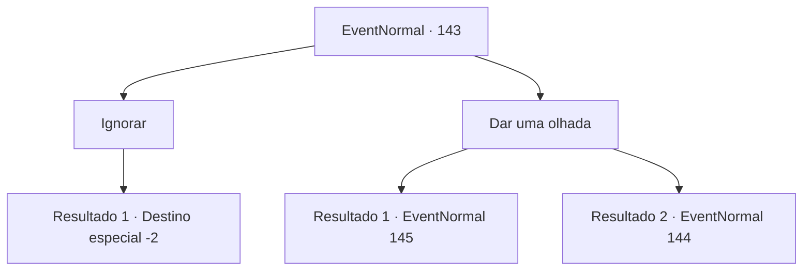

# Eventos normais · 143

[Índice da tabela](index.md) · [Índice geral](../index.md)

ID: `pt:EventNormal:143` · Fonte: `EventNormal4` · Versão: 1.2.47.

Mapeamento estático dos arquivos; a disponibilidade e a execução dependem do estado da run.

## Texto do evento

Você passa por um cemitério assustador no meio da noite. Um uivo ecoa de dentro de seus portões. Você não tem certeza se é de uma fera ou de um homem. 

## Dados de entrada

```json
{
  "id": 143,
  "grade": 1,
  "place": "",
  "required": ""
}
```

## Mapa das escolhas



## Escolhas e resultados

### Escolha 1

Ignorar

Requisitos e outros campos da escolha:

```json
{
  "required": ""
}
```

#### Resultado 1.1

Você passa correndo pelo cemitério.

Continuação registrada: [Destino especial `-2`](../destinos-especiais.md).

```json
{
  "required": "",
  "chance": "1",
  "nextEvent": -2,
  "type": 2,
  "reward": ""
}
```

### Escolha 2

Dar uma olhada

Requisitos e outros campos da escolha:

```json
{
  "required": ""
}
```

#### Resultado 2.1

Você não consegue resistir à sua curiosidade e decide investigar. Nas profundezas do cemitério entre lápides irregulares, você vê uma figura humana se alimentando dos cadáveres. Você tenta dar uma olhada mais de perto, mas acidentalmente pisa em um galho. O estalo soa mais alto no ar frio da noite, e o monstro canibal vira a cabeça em sua direção. 

 "Grrrrr..."

 Ele mostra os dentes e vem correndo em sua direção.

Continuação registrada: [Evento 145](0145.md) na mesma tabela.

```json
{
  "required": "2_14_10",
  "chance": "1",
  "nextEvent": 145,
  "type": 2,
  "reward": "6_3_84",
  "place": 1
}
```

#### Resultado 2.2

Você não consegue resistir à sua curiosidade e decide investigar. Nas profundezas do cemitério entre lápides cobertas de musgo, você vê uma figura humana se alimentando dos cadáveres. Você reconhece que é um monstro canibal.

Continuação registrada: [Evento 144](0144.md) na mesma tabela.

```json
{
  "required": "1_14_10",
  "chance": "1",
  "nextEvent": 144,
  "type": 2,
  "reward": ""
}
```

## Referências que chegam a este evento

Nenhum `nextEvent` positivo da mesma tabela aponta para este nó. Isso não prova que seja inacessível: sorteio e estado de história podem selecioná-lo.

