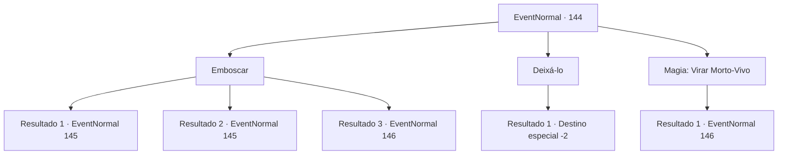

# Eventos normais · 144

[Índice da tabela](index.md) · [Índice geral](../index.md)

ID: `pt:EventNormal:144` · Fonte: `EventNormal4` · Versão: 1.2.47.

Mapeamento estático dos arquivos; a disponibilidade e a execução dependem do estado da run.

## Texto do evento

*Sem texto no arquivo.*

## Dados de entrada

```json
{
  "id": 144,
  "grade": 1,
  "place": "",
  "required": ""
}
```

## Mapa das escolhas



## Escolhas e resultados

### Escolha 1

Emboscar

Requisitos e outros campos da escolha:

```json
{
  "required": ""
}
```

#### Resultado 1.1

Você se esgueira até o monstro canibal por trás. Mas então você pisa em um galho. O estalo soa mais alto no ar frio da noite, e o canibal vira a cabeça em sua direção. 

 "Grrrrr..."

 Ele mostra os dentes e vem correndo em sua direção.

Continuação registrada: [Evento 145](0145.md) na mesma tabela.

```json
{
  "required": "21_5_0",
  "chance": "25",
  "nextEvent": 145,
  "type": 1,
  "reward": "6_3_84",
  "place": 1
}
```

#### Resultado 1.2

Você se esgueira até o monstro canibal por trás. Mas então você pisa em um galho. O estalo soa mais alto no ar frio da noite, e o canibal vira a cabeça em sua direção. 

 "Grrrrr..."

 Ele mostra os dentes e vem correndo em sua direção.

Continuação registrada: [Evento 145](0145.md) na mesma tabela.

```json
{
  "required": "20_5_0",
  "chance": "12",
  "nextEvent": 145,
  "type": 1,
  "reward": "6_3_84",
  "place": 1
}
```

#### Resultado 1.3

Você se esgueira para o monstro canibal por trás e acerta-o rapidamente. O ataque o mata instantaneamente. Você fica com o corpo do canibal e o cadáver do qual ele estava se alimentando.

Continuação registrada: [Evento 146](0146.md) na mesma tabela.

```json
{
  "required": "",
  "chance": "1|0_6_1",
  "nextEvent": 146,
  "type": 0,
  "reward": "0_2_2"
}
```

### Escolha 2

Deixá-lo

Requisitos e outros campos da escolha:

```json
{
  "required": ""
}
```

#### Resultado 2.1

Você passa correndo pelo monstro canibal e seu banquete, e sai do cemitério.

Continuação registrada: [Destino especial `-2`](../destinos-especiais.md).

```json
{
  "required": "",
  "chance": "1",
  "nextEvent": -2,
  "type": 2,
  "reward": ""
}
```

### Escolha 3

Magia: Virar Morto-Vivo

Requisitos e outros campos da escolha:

```json
{
  "required": "20_0_1|20_3_1"
}
```

#### Resultado 3.1

Você lança um encantamento para devolver os mortos-vivos de volta ao submundo. Uma luz sagrada transforma o corpo do monstro canibal em cinzas. Na sua frente agora está o cadáver que o canibal estava mordiscando, e o que costumava ser o canibal.

Continuação registrada: [Evento 146](0146.md) na mesma tabela.

```json
{
  "required": "",
  "chance": "1",
  "nextEvent": 146,
  "type": 2,
  "reward": "0_2_2"
}
```

## Referências que chegam a este evento

- [Evento 143 · escolha 2 · resultado 2](0143.md#escolha-2)
