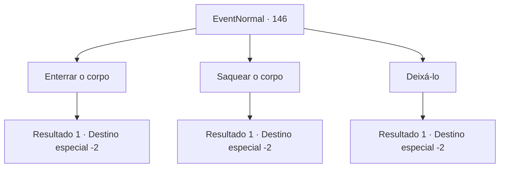

# Eventos normais · 146

[Índice da tabela](index.md) · [Índice geral](../index.md)

ID: `pt:EventNormal:146` · Fonte: `EventNormal4` · Versão: 1.2.47.

Mapeamento estático dos arquivos; a disponibilidade e a execução dependem do estado da run.

## Texto do evento

*Sem texto no arquivo.*

## Dados de entrada

```json
{
  "id": 146,
  "grade": 1,
  "place": "",
  "required": ""
}
```

## Mapa das escolhas



## Escolhas e resultados

### Escolha 1

Enterrar o corpo

Requisitos e outros campos da escolha:

```json
{
  "required": ""
}
```

#### Resultado 1.1

Você joga o cadáver de volta em sua cova desenterrada. Então você o cobre com terra. Que esta pobre alma descanse em paz.

Continuação registrada: [Destino especial `-2`](../destinos-especiais.md).

```json
{
  "required": "",
  "chance": "1",
  "nextEvent": -2,
  "type": 2,
  "reward": "0_3_2"
}
```

### Escolha 2

Saquear o corpo

Requisitos e outros campos da escolha:

```json
{
  "required": "2_3_0"
}
```

#### Resultado 2.1

Você vasculha os pertences dos mortos, e encontra dinheiro destinado à vida após a morte. Você pega ansiosamente e sai do cemitério.

Continuação registrada: [Destino especial `-2`](../destinos-especiais.md).

```json
{
  "required": "",
  "chance": "1",
  "nextEvent": -2,
  "type": 2,
  "reward": "0_3_-3|0_4_50|0_2_1"
}
```

### Escolha 3

Deixá-lo

Requisitos e outros campos da escolha:

```json
{
  "required": ""
}
```

#### Resultado 3.1

Você deixa o corpo como está e sai do cemitério.

Continuação registrada: [Destino especial `-2`](../destinos-especiais.md).

```json
{
  "required": "",
  "chance": "1",
  "nextEvent": -2,
  "type": 2,
  "reward": ""
}
```

## Referências que chegam a este evento

- [Evento 144 · escolha 1 · resultado 3](0144.md#escolha-1)
- [Evento 144 · escolha 3 · resultado 1](0144.md#escolha-3)
- [Evento 145 · escolha 1 · resultado 1](0145.md#escolha-1)
