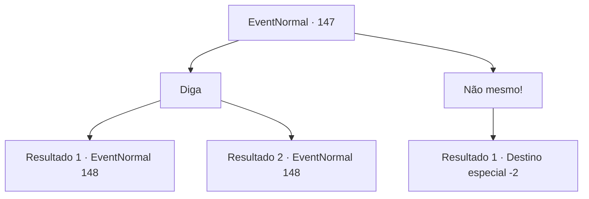

# Eventos normais · 147

[Índice da tabela](index.md) · [Índice geral](../index.md)

ID: `pt:EventNormal:147` · Fonte: `EventNormal4` · Versão: 1.2.47.

Mapeamento estático dos arquivos; a disponibilidade e a execução dependem do estado da run.

## Texto do evento

Você encontra um homem carrancudo em uma praia de cascalho. Seu avental e luvas estão cobertos de fuligem. Ele ouve seus passos e se aproxima de você com cuidado. 

 "Aventureiro... Posso te pedir um favor?"


## Dados de entrada

```json
{
  "id": 147,
  "grade": 1,
  "place": "",
  "required": "5_581_0"
}
```

## Mapa das escolhas



## Escolhas e resultados

### Escolha 1

Diga

Requisitos e outros campos da escolha:

```json
{
  "required": ""
}
```

#### Resultado 1.1

Você acena com a cabeça, e ele fica animado. 

 "Sou um aprendiz de ferreiro procurando novos tipos de materiais para armas. Recentemente, aprendi que as escamas do gato-do-mar estão entre as mais fortes e flexíveis. Então eu vim para o oceano mais próximo com esta vara de pescar."

 Ele lhe entrega sua vara de pescar surrada e pede ajuda.

Continuação registrada: [Evento 148](0148.md) na mesma tabela.

```json
{
  "required": "10_43_1",
  "chance": "1",
  "nextEvent": 148,
  "type": 2,
  "reward": "3_43_1|5_132_1|5_581_1"
}
```

#### Resultado 1.2

Você acena com a cabeça, e ele fica animado. 

 "Sou um aprendiz de ferreiro procurando novos tipos de materiais para armas. Recentemente, aprendi que as escamas do gato-do-mar estão entre as mais fortes e flexíveis. Então eu vim para o oceano mais próximo com esta vara de pescar."


Continuação registrada: [Evento 148](0148.md) na mesma tabela.

```json
{
  "required": "8_43_1",
  "chance": "1",
  "nextEvent": 148,
  "type": 2,
  "reward": "5_581_1"
}
```

### Escolha 2

Não mesmo!

Requisitos e outros campos da escolha:

```json
{
  "required": ""
}
```

#### Resultado 2.1

Você balança a cabeça. 'Ah, bem', ele diz desapontado, e caminha em direção à água sozinho.

Continuação registrada: [Destino especial `-2`](../destinos-especiais.md).

```json
{
  "required": "",
  "chance": "1",
  "nextEvent": -2,
  "type": 2,
  "reward": "5_581_1"
}
```

## Referências que chegam a este evento

Nenhum `nextEvent` positivo da mesma tabela aponta para este nó. Isso não prova que seja inacessível: sorteio e estado de história podem selecioná-lo.

