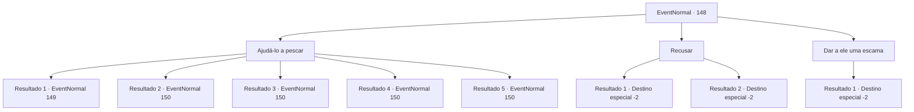

# Eventos normais · 148

[Índice da tabela](index.md) · [Índice geral](../index.md)

ID: `pt:EventNormal:148` · Fonte: `EventNormal4` · Versão: 1.2.47.

Mapeamento estático dos arquivos; a disponibilidade e a execução dependem do estado da run.

## Texto do evento

*Sem texto no arquivo.*

## Dados de entrada

```json
{
  "id": 148,
  "grade": 1,
  "place": "",
  "required": ""
}
```

## Mapa das escolhas



## Escolhas e resultados

### Escolha 1

Ajudá-lo a pescar

Requisitos e outros campos da escolha:

```json
{
  "required": ""
}
```

#### Resultado 1.1

Você decide ajudar o homem a pescar um gato-do-mar. Ele não trouxe nenhuma isca boa, mas improvisa com uma minhoca gorda que encontrou nas proximidades. 
 
 Assim como o tédio começa a deixá-lo sonolento, a ponta da vara de pescar começa a tremer.

Continuação registrada: [Evento 149](0149.md) na mesma tabela.

```json
{
  "required": "10_124_1|10_125_1|10_143_1|10_144_1",
  "chance": "1",
  "nextEvent": 149,
  "type": 2,
  "reward": ""
}
```

#### Resultado 1.2

Você decide ajudar o homem a pescar um gato-do-mar. Você corta um pedaço de sua cavala para usar como isca. 
 
 Assim como o tédio começa a deixá-lo sonolento, a ponta da vara de pescar começa a tremer.

Continuação registrada: [Evento 150](0150.md) na mesma tabela.

```json
{
  "required": "8_124_1",
  "chance": "1",
  "nextEvent": 150,
  "type": 2,
  "reward": "4_124_1"
}
```

#### Resultado 1.3

Você decide ajudar o homem a pescar um gato-do-mar. Você corta um pedaço do seu precioso pargo para usar como isca. 
 Alguns momentos depois, a ponta da vara de pescar começa a tremer.

Continuação registrada: [Evento 150](0150.md) na mesma tabela.

```json
{
  "required": "8_125_1",
  "chance": "1",
  "nextEvent": 150,
  "type": 2,
  "reward": "4_125_1"
}
```

#### Resultado 1.4

Você decide ajudar o homem a pescar um gato-do-mar. Você corta um pedaço de seu salmão para usar como isca. 
 
 Assim como o tédio começa a deixá-lo sonolento, a ponta da vara de pescar começa a tremer.

Continuação registrada: [Evento 150](0150.md) na mesma tabela.

```json
{
  "required": "8_144_1",
  "chance": "1",
  "nextEvent": 150,
  "type": 2,
  "reward": "4_143_1"
}
```

#### Resultado 1.5

Você decide ajudar o homem a pescar um gato-do-mar. Você corta um pedaço de sua carpa para usar como isca. 
 Alguns momentos depois, a ponta da vara de pescar começa a tremer.

Continuação registrada: [Evento 150](0150.md) na mesma tabela.

```json
{
  "required": "8_143_1",
  "chance": "1",
  "nextEvent": 150,
  "type": 2,
  "reward": "4_144_1"
}
```

### Escolha 2

Recusar

Requisitos e outros campos da escolha:

```json
{
  "required": ""
}
```

#### Resultado 2.1

Você balança a cabeça. 'Ah, bem', ele diz desapontado, e caminha em direção à água sozinho.

Continuação registrada: [Destino especial `-2`](../destinos-especiais.md).

```json
{
  "required": "5_132_1",
  "chance": "1",
  "nextEvent": -2,
  "type": 2,
  "reward": "4_43_1"
}
```

#### Resultado 2.2

Você balança a cabeça. 'Ah, bem', ele diz desapontado, e caminha em direção à água sozinho.

Continuação registrada: [Destino especial `-2`](../destinos-especiais.md).

```json
{
  "required": "18_132_1",
  "chance": "1",
  "nextEvent": -2,
  "type": 2,
  "reward": ""
}
```

### Escolha 3

Dar a ele uma escama

Requisitos e outros campos da escolha:

```json
{
  "required": "8_127_1"
}
```

#### Resultado 3.1

Você entrega a ele sua escama de gato-do-mar. Ele agradece, seus olhos brilhando com respeito. 

 "Muito obrigado..! Espere, eu tenho algo para você!"

 Ele pega a escama e desaparece em sua pequena forja. 

 Depois de algum tempo, ele volta para você com algo. É um escudo liso e iridescente. 

 "Fiz isso para testar minhas habilidades, mas ficou muito bom. Espero que faça bom uso dela. Obrigado por sua ajuda, aventureiro."

 Você pega o escudo e coloca na sua mochila.

Continuação registrada: [Destino especial `-2`](../destinos-especiais.md).

```json
{
  "required": "",
  "chance": "1",
  "nextEvent": -2,
  "type": 2,
  "reward": "3_118_1|0_2_1|4_127_1"
}
```

## Referências que chegam a este evento

- [Evento 147 · escolha 1 · resultado 1](0147.md#escolha-1)
- [Evento 147 · escolha 1 · resultado 2](0147.md#escolha-1)
