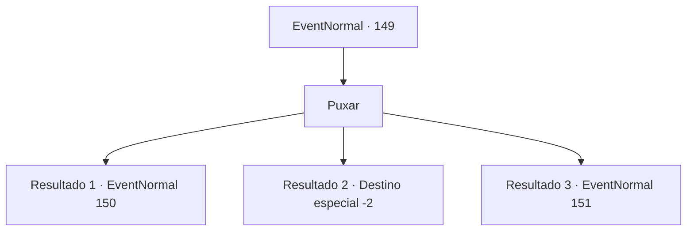

# Eventos normais · 149

[Índice da tabela](index.md) · [Índice geral](../index.md)

ID: `pt:EventNormal:149` · Fonte: `EventNormal4` · Versão: 1.2.47.

Mapeamento estático dos arquivos; a disponibilidade e a execução dependem do estado da run.

## Texto do evento

*Sem texto no arquivo.*

## Dados de entrada

```json
{
  "id": 149,
  "grade": 1,
  "place": "",
  "required": ""
}
```

## Mapa das escolhas



## Escolhas e resultados

### Escolha 1

Puxar

Requisitos e outros campos da escolha:

```json
{
  "required": ""
}
```

#### Resultado 1.1

Você pesca uma cavala fresca. O ferreiro a pega e começa a cortá-la desajeitadamente. 

 "Não é nenhum gato-do-mar... mas quem sabe, podemos ter sucesso com uma isca melhor."

 Ele joga o anzol de volta na água com uma sensação de esperança. 
 
 Assim como o tédio começa a deixá-lo sonolento, a ponta da vara de pescar começa a tremer.

Continuação registrada: [Evento 150](0150.md) na mesma tabela.

```json
{
  "required": "",
  "chance": "10",
  "nextEvent": 150,
  "type": 2,
  "reward": ""
}
```

#### Resultado 1.2

Você puxa a vara apenas para encontrar um gancho vazio. Ele solta um suspiro desapontado. 

 "Ah... Eu acho que isso não vai funcionar. Oh bem... Desculpe desperdiçar seu tempo."

 Ele pega a vara de pescar e volta para a cidade.

Continuação registrada: [Destino especial `-2`](../destinos-especiais.md).

```json
{
  "required": "",
  "chance": "20",
  "nextEvent": -2,
  "type": 2,
  "reward": ""
}
```

#### Resultado 1.3

A vara quebra assim que você a pega, e da água salta um gato-do-mar. Ele está muito bravo por ter um anzol na boca. 

 "Ah...AAAH! Aventureiro!"

 O ferreiro luta pelas suas costas.

Continuação registrada: [Evento 151](0151.md) na mesma tabela.

```json
{
  "required": "",
  "chance": "2",
  "nextEvent": 151,
  "type": 2,
  "reward": "6_0_44",
  "place": 12
}
```

## Referências que chegam a este evento

- [Evento 148 · escolha 1 · resultado 1](0148.md#escolha-1)
