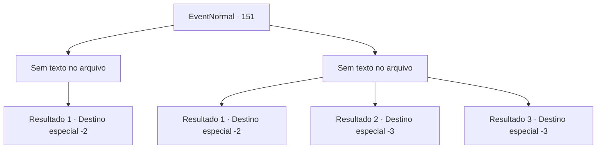

# Eventos normais · 151

[Índice da tabela](index.md) · [Índice geral](../index.md)

ID: `pt:EventNormal:151` · Fonte: `EventNormal4` · Versão: 1.2.47.

Mapeamento estático dos arquivos; a disponibilidade e a execução dependem do estado da run.

## Texto do evento

*Sem texto no arquivo.*

## Dados de entrada

```json
{
  "id": 151,
  "grade": 1,
  "place": "",
  "required": ""
}
```

## Mapa das escolhas



## Escolhas e resultados

### Escolha 1

*Sem texto no arquivo; o papel dessa opção depende da interface do jogo.*

Requisitos e outros campos da escolha:

```json
{
  "required": ""
}
```

#### Resultado 1.1


 "Grrgh...grrrr..."

 O gato-do-mar luta ferozmente, mas não é páreo para você. Você e o ferreiro descamam o gato marinho. Ele agradece, seus olhos brilham com respeito. 

 "Muito obrigado..! Espere, eu tenho algo para você!"

 Ele pega a escama e desaparece em sua pequena forja. 

 Depois de algum tempo, ele volta para você com algo. É um escudo liso e iridescente. 

 "Fiz isso para testar minhas habilidades, mas ficou muito bom. Espero que faça bom uso dele. Obrigado por sua ajuda, aventureiro."

 Você pega o escudo e coloca na sua mochila.

Continuação registrada: [Destino especial `-2`](../destinos-especiais.md).

```json
{
  "required": "",
  "chance": "1",
  "nextEvent": -2,
  "type": 2,
  "reward": "3_118_1|0_2_1"
}
```

### Escolha 2

*Sem texto no arquivo; o papel dessa opção depende da interface do jogo.*

Requisitos e outros campos da escolha:

```json
{
  "required": ""
}
```

#### Resultado 2.1

O gato-do-mar luta ferozmente. Você é ferido por suas garras e dentes antes de correr para salvar sua vida.

Continuação registrada: [Destino especial `-2`](../destinos-especiais.md).

```json
{
  "required": "1_0_2|1_1_2",
  "chance": "1",
  "nextEvent": -2,
  "type": 2,
  "reward": "0_0_-1|0_1_-1"
}
```

#### Resultado 2.2

O gato-do-mar come você de almoço.

Continuação registrada: [Destino especial `-3`](../destinos-especiais.md).

```json
{
  "required": "2_0_2",
  "chance": "1",
  "nextEvent": -3,
  "type": 2,
  "reward": "0_0_-1|0_1_-1"
}
```

#### Resultado 2.3

O gato-do-mar come você de almoço.

Continuação registrada: [Destino especial `-3`](../destinos-especiais.md).

```json
{
  "required": "2_1_2",
  "chance": "1",
  "nextEvent": -3,
  "type": 2,
  "reward": "0_0_-1|0_1_-1"
}
```

## Referências que chegam a este evento

- [Evento 149 · escolha 1 · resultado 3](0149.md#escolha-1)
- [Evento 150 · escolha 1 · resultado 4](0150.md#escolha-1)
