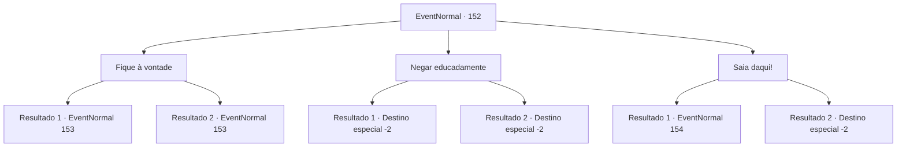

# Eventos normais · 152

[Índice da tabela](index.md) · [Índice geral](../index.md)

ID: `pt:EventNormal:152` · Fonte: `EventNormal4` · Versão: 1.2.47.

Mapeamento estático dos arquivos; a disponibilidade e a execução dependem do estado da run.

## Texto do evento

Você está passando por uma fonte da praça da cidade. De repente, alguém chama você com uma voz desconfortavelmente sedutora. 

 "Você está perdida, boneca?"

 Ele é um jovem bonito com cabelos loiros brilhantes. Suas orelhas pontudas sugerem que ele é um híbrido. Ele toca seu alaúde com uma habilidosa graciosidade ao se aproximar de você. 

 "Bem, eu certamente estou... no abismo de sua beleza sublime! Eu sou o Alvin, prazer em conhecê-la. Você poderia gentilmente me permitir escrever uma música sobre você?"


## Dados de entrada

```json
{
  "id": 152,
  "grade": 1,
  "place": "",
  "required": "11_0_1|1_12_12|5_100_0"
}
```

## Mapa das escolhas



## Escolhas e resultados

### Escolha 1

Fique à vontade

Requisitos e outros campos da escolha:

```json
{
  "required": ""
}
```

#### Resultado 1.1

Alvin começa a cantar ao som de seu alaúde sobre como você é fascinantemente linda. As pessoas param para ouvir a música dele e olham para você. Eles acenam, batem palmas e ocasionalmente jogam moedas nele. Alvin termina de cantar. Ele pega o ouro enquanto fala com você em um sussurro sedutor. 

 "Ó doce deusa minha... eu te imploro para acender minha inspiração musical esta noite!"


Continuação registrada: [Evento 153](0153.md) na mesma tabela.

```json
{
  "required": "1_12_18",
  "chance": "1",
  "nextEvent": 153,
  "type": 2,
  "reward": ""
}
```

#### Resultado 1.2

Alvin começa a cantar ao som de seu alaúde sobre como você é fascinantemente linda. As pessoas param para ouvir a música dele e olham para você. Eles começam a sussurrar entre si. 

 "Bem, ela não é tão bonita..."

 "Pelo menos a música é boa."

 Elas jogam algumas moedas de ouro para ele enquanto ouvem. Alvin termina de cantar. Ele capta os poucos momentos dourados enquanto fala com você em um sussurro sedutor. 

 "Ó doce deusa minha... eu te imploro para acender minha inspiração musical esta noite!"


Continuação registrada: [Evento 153](0153.md) na mesma tabela.

```json
{
  "required": "2_12_18",
  "chance": "1",
  "nextEvent": 153,
  "type": 2,
  "reward": ""
}
```

### Escolha 2

Negar educadamente

Requisitos e outros campos da escolha:

```json
{
  "required": ""
}
```

#### Resultado 2.1


 "Mais uma mulher de classe e elegância...!"

 Alvin ignora sua recusa e começa a cantar ao som de seu alaúde. Ele continua falando sobre como você é hipnotizante e linda. As pessoas param para ouvir a música dele e olham para você. Elas acenam, batem palmas e ocasionalmente jogam moedas nele. Você não aguenta mais o constrangimento e decide correr.

Continuação registrada: [Destino especial `-2`](../destinos-especiais.md).

```json
{
  "required": "1_12_18",
  "chance": "1",
  "nextEvent": -2,
  "type": 2,
  "reward": "5_100_9"
}
```

#### Resultado 2.2


 "Mais uma mulher de classe e elegância...!"

 Alvin ignora sua recusa e começa a cantar ao som de seu alaúde. Ele continua falando sobre como você é hipnotizante e linda. As pessoas param para ouvir a música dele e olham para você. Elas começam a sussurrar entre si. 

 "Bem, ela não é tão bonita..."

 "Pelo menos a música é boa."

 Elas jogam algumas moedas de ouro para ele enquanto ouvem. Você não aguenta mais o constrangimento e decide correr.

Continuação registrada: [Destino especial `-2`](../destinos-especiais.md).

```json
{
  "required": "2_12_18",
  "chance": "1",
  "nextEvent": -2,
  "type": 2,
  "reward": "5_100_9"
}
```

### Escolha 3

Saia daqui!

Requisitos e outros campos da escolha:

```json
{
  "required": "2_3_0"
}
```

#### Resultado 3.1

Você franze a testa e o empurra para longe. 

 "Ah, toda rosa tem seus espinhos."

 Alvin ignora sua recusa e começa a cantar ao som de seu alaúde. Ele continua e fala sobre como você é fascinantemente linda.

Continuação registrada: [Evento 154](0154.md) na mesma tabela.

```json
{
  "required": "1_12_18",
  "chance": "1",
  "nextEvent": 154,
  "type": 2,
  "reward": ""
}
```

#### Resultado 3.2

Você franze a testa e o empurra para longe. Ele parece um pouco magoado quando dá um passo para trás. 

 "Não precisa ser tão rude... Bom, adeus."

 Então ele pega seu alaúde e vai embora.

Continuação registrada: [Destino especial `-2`](../destinos-especiais.md).

```json
{
  "required": "2_12_18",
  "chance": "1",
  "nextEvent": -2,
  "type": 2,
  "reward": "0_3_-1|5_100_9"
}
```

## Referências que chegam a este evento

Nenhum `nextEvent` positivo da mesma tabela aponta para este nó. Isso não prova que seja inacessível: sorteio e estado de história podem selecioná-lo.

