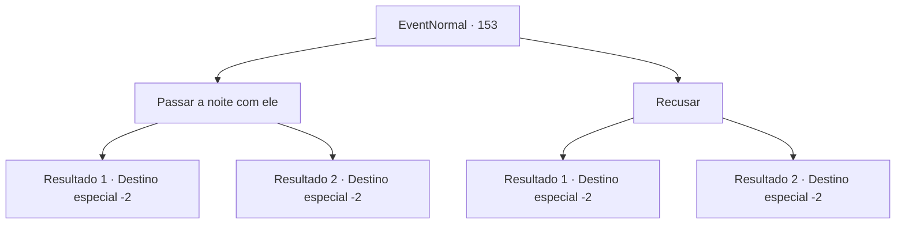

# Eventos normais · 153

[Índice da tabela](index.md) · [Índice geral](../index.md)

ID: `pt:EventNormal:153` · Fonte: `EventNormal4` · Versão: 1.2.47.

Mapeamento estático dos arquivos; a disponibilidade e a execução dependem do estado da run.

## Texto do evento

*Sem texto no arquivo.*

## Dados de entrada

```json
{
  "id": 153,
  "grade": 1,
  "place": "",
  "required": ""
}
```

## Mapa das escolhas



## Escolhas e resultados

### Escolha 1

Passar a noite com ele

Requisitos e outros campos da escolha:

```json
{
  "required": ""
}
```

#### Resultado 1.1

Você passa uma noite romântica com Alvin. Seus olhos brilham ao luar enquanto ele fala com você. 

 "Palavras não podem descrever o quão grato eu sou. Você me presenteou com a melhor música que já escrevi."

 Quando você acorda de manhã, ele se foi. Você coloca suas roupas de volta e continua sua jornada.

Continuação registrada: [Destino especial `-2`](../destinos-especiais.md).

```json
{
  "required": "24_1_1",
  "chance": "1",
  "nextEvent": -2,
  "type": 2,
  "reward": "0_1_1|5_100_1"
}
```

#### Resultado 1.2

Você pensa brevemente em seu amante, mas decide se concentrar no momento. Você passa uma noite romântica com Alvin. Seus olhos brilham ao luar enquanto ele fala com você. 

 "Palavras não podem descrever o quão grato eu sou. Você me presenteou com a melhor música que já escrevi."

 Quando você acorda de manhã, ele se foi. Você coloca suas roupas de volta e continua sua jornada.

Continuação registrada: [Destino especial `-2`](../destinos-especiais.md).

```json
{
  "required": "23_1_1",
  "chance": "1",
  "nextEvent": -2,
  "type": 2,
  "reward": "0_1_1|5_100_1|0_3_-5"
}
```

### Escolha 2

Recusar

Requisitos e outros campos da escolha:

```json
{
  "required": ""
}
```

#### Resultado 2.1

Você se recusa a passar a noite com ele. Ele parece desapontado quando dá um passo para trás. 

 "Às vezes a beleza está no que não pode ser adquirido. Até nos encontrarmos novamente..."

 Você ignora seus olhos tristes e continua sua jornada.

Continuação registrada: [Destino especial `-2`](../destinos-especiais.md).

```json
{
  "required": "24_1_1",
  "chance": "1",
  "nextEvent": -2,
  "type": 2,
  "reward": "5_100_9"
}
```

#### Resultado 2.2

Você pensa em seu amante e se recusa a passar a noite com ele. Ele parece desapontado quando dá um passo para trás. 

 "Às vezes a beleza está no que não pode ser adquirido. Até nos encontrarmos novamente..."

 Você ignora seus olhos tristes e continua sua jornada.

Continuação registrada: [Destino especial `-2`](../destinos-especiais.md).

```json
{
  "required": "23_1_1",
  "chance": "1",
  "nextEvent": -2,
  "type": 2,
  "reward": "5_100_9|0_3_1"
}
```

## Referências que chegam a este evento

- [Evento 152 · escolha 1 · resultado 1](0152.md#escolha-1)
- [Evento 152 · escolha 1 · resultado 2](0152.md#escolha-1)
