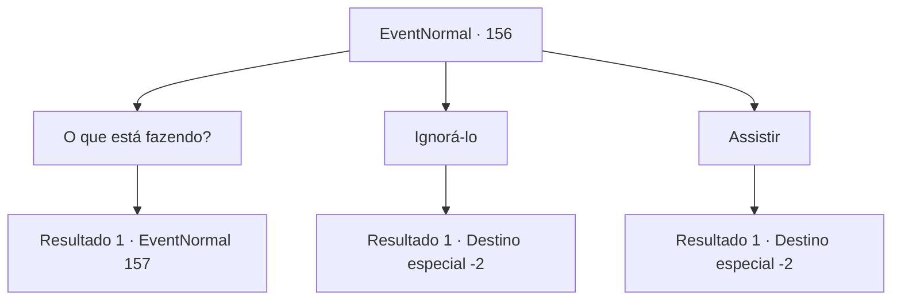

# Eventos normais · 156

[Índice da tabela](index.md) · [Índice geral](../index.md)

ID: `pt:EventNormal:156` · Fonte: `EventNormal4` · Versão: 1.2.47.

Mapeamento estático dos arquivos; a disponibilidade e a execução dependem do estado da run.

## Texto do evento

Você se depara com Alvin novamente perto de um porto marítimo. Ele está cantando na praça da cidade como antes, só que desta vez ele está cantando sobre outra mulher. Ele elogia sua beleza hipnotizante, olhando para ela da mesma maneira que ele olhou para você. 

## Dados de entrada

```json
{
  "id": 156,
  "grade": 2,
  "place": "",
  "required": "5_100_1"
}
```

## Mapa das escolhas



## Escolhas e resultados

### Escolha 1

O que está fazendo?

Requisitos e outros campos da escolha:

```json
{
  "required": ""
}
```

#### Resultado 1.1

Você vai até Alvin e pergunta o que ele está fazendo. Irritado, ele te olha de lado e responde. 

 "Vamos lá... isso foi apenas uma noite. Por favor, não tente me segurar. Eu sou como o vento suave... quente, mas livre."

 Em seguida, ele aponta para a multidão. 

 "Você está me fazendo ficar mal na frente dos meus convidados. Você poderia, por favor, sair?"


Continuação registrada: [Evento 157](0157.md) na mesma tabela.

```json
{
  "required": "",
  "chance": "1",
  "nextEvent": 157,
  "type": 2,
  "reward": ""
}
```

### Escolha 2

Ignorá-lo

Requisitos e outros campos da escolha:

```json
{
  "required": ""
}
```

#### Resultado 2.1

Você nunca esperou nada melhor dele, então você o deixa em paz e segue em frente.

Continuação registrada: [Destino especial `-2`](../destinos-especiais.md).

```json
{
  "required": "",
  "chance": "1",
  "nextEvent": -2,
  "type": 2,
  "reward": "0_2_1"
}
```

### Escolha 3

Assistir

Requisitos e outros campos da escolha:

```json
{
  "required": ""
}
```

#### Resultado 3.1

Você o vê tocar e cantar. Alvin tem talento para compor, e sua nova deusa parece muito impressionada enquanto ouve sua bela melodia. Depois que ele termina de cantar, ele te ignora e vai embora com sua nova namorada.

Continuação registrada: [Destino especial `-2`](../destinos-especiais.md).

```json
{
  "required": "",
  "chance": "1",
  "nextEvent": -2,
  "type": 2,
  "reward": "0_2_1"
}
```

## Referências que chegam a este evento

Nenhum `nextEvent` positivo da mesma tabela aponta para este nó. Isso não prova que seja inacessível: sorteio e estado de história podem selecioná-lo.

