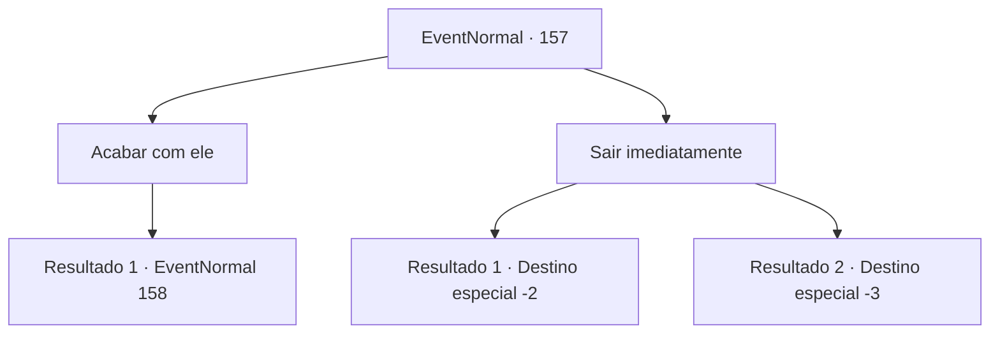

# Eventos normais · 157

[Índice da tabela](index.md) · [Índice geral](../index.md)

ID: `pt:EventNormal:157` · Fonte: `EventNormal4` · Versão: 1.2.47.

Mapeamento estático dos arquivos; a disponibilidade e a execução dependem do estado da run.

## Texto do evento

*Sem texto no arquivo.*

## Dados de entrada

```json
{
  "id": 157,
  "grade": 1,
  "place": "",
  "required": ""
}
```

## Mapa das escolhas



## Escolhas e resultados

### Escolha 1

Acabar com ele

Requisitos e outros campos da escolha:

```json
{
  "required": ""
}
```

#### Resultado 1.1

Você não aguenta mais e saca sua arma. Ele para de tocar e lhe dá um olhar triste. 

 "Eu não quero brigar com você, boneca..."


Continuação registrada: [Evento 158](0158.md) na mesma tabela.

```json
{
  "required": "",
  "chance": "1",
  "nextEvent": 158,
  "type": 2,
  "reward": "6_0_34|5_100_9",
  "place": 4
}
```

### Escolha 2

Sair imediatamente

Requisitos e outros campos da escolha:

```json
{
  "required": ""
}
```

#### Resultado 2.1

Você sente seu rosto queimar de vergonha e decide correr.

Continuação registrada: [Destino especial `-2`](../destinos-especiais.md).

```json
{
  "required": "1_1_2",
  "chance": "1",
  "nextEvent": -2,
  "type": 2,
  "reward": "5_100_9|0_1_-1"
}
```

#### Resultado 2.2

Você desmaia de imensa frustração. Ele grita com uma voz surpresa quando você cai. 

 "Garotinha, não!"

 Sua voz desaparece junto com o resto do mundo.

Continuação registrada: [Destino especial `-3`](../destinos-especiais.md).

```json
{
  "required": "2_1_2",
  "chance": "1",
  "nextEvent": -3,
  "type": 2,
  "reward": "0_1_-1"
}
```

## Referências que chegam a este evento

- [Evento 156 · escolha 1 · resultado 1](0156.md#escolha-1)
