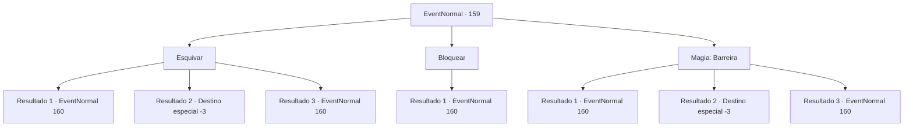

# Eventos normais · 159

[Índice da tabela](index.md) · [Índice geral](../index.md)

ID: `pt:EventNormal:159` · Fonte: `EventNormal4` · Versão: 1.2.47.

Mapeamento estático dos arquivos; a disponibilidade e a execução dependem do estado da run.

## Texto do evento

Você está apreciando o pôr do sol enquanto viaja por uma trilha.
 O vento do topo da montanha toca seu nariz com um cheiro sinistro. E com isso, flechas caem sobre você.

## Dados de entrada

```json
{
  "id": 159,
  "grade": 1,
  "place": "",
  "required": "5_115_0|1_2_20"
}
```

## Mapa das escolhas



## Escolhas e resultados

### Escolha 1

Esquivar

Requisitos e outros campos da escolha:

```json
{
  "required": ""
}
```

#### Resultado 1.1

Você não consegue desviar de todas as flechas. Alguns pousam em sua armadura e corpo. O sangue pinga no chão. Os atiradores surgem dos arbustos. Eles são goblins bem armados, e um deles grita. 

 "Peguem o humano!"

 Hobgoblins gritam enquanto avançam até você.

Continuação registrada: [Evento 160](0160.md) na mesma tabela.

```json
{
  "required": "1_0_2",
  "chance": "14",
  "nextEvent": 160,
  "type": 1,
  "reward": "6_3_22|0_0_-1",
  "place": 1
}
```

#### Resultado 1.2

Você não consegue desviar de todas as flechas. Alguns perfuram sua armadura e pele. O sangue pinga no chão. Sua mente desaparece enquanto goblins surgem dos arbustos.

Continuação registrada: [Destino especial `-3`](../destinos-especiais.md).

```json
{
  "required": "2_0_2",
  "chance": "14",
  "nextEvent": -3,
  "type": 1,
  "reward": "0_0_-1"
}
```

#### Resultado 1.3

Você esquiva com sucesso de cada flecha. Os atiradores surgem dos arbustos. Eles são goblins bem armados, e um deles grita. 

 "Não fiquem parados, cacem aquele humano!"

 Os hobgoblins hesitam, mas logo sacam suas armas e avançam em você sob a pressão de seu líder.

Continuação registrada: [Evento 160](0160.md) na mesma tabela.

```json
{
  "required": "",
  "chance": "1|0_6_1",
  "nextEvent": 160,
  "type": 0,
  "reward": "6_3_22",
  "place": 1
}
```

### Escolha 2

Bloquear

Requisitos e outros campos da escolha:

```json
{
  "required": "20_9_1"
}
```

#### Resultado 2.1

Você esquiva com sucesso de cada flecha. Os atiradores surgem dos arbustos. Eles são goblins bem armados, e um deles grita. 

 "Não fiquem parados, cacem aquele humano!"

 Os hobgoblins hesitam, mas logo sacam suas armas e avançam em você sob a pressão de seu líder.

Continuação registrada: [Evento 160](0160.md) na mesma tabela.

```json
{
  "required": "",
  "chance": "1",
  "nextEvent": 160,
  "type": 2,
  "reward": "6_0_22",
  "place": 1
}
```

### Escolha 3

Magia: Barreira

Requisitos e outros campos da escolha:

```json
{
  "required": "20_0_2|1_1_2"
}
```

#### Resultado 3.1

Você não consegue lançar o feitiço a tempo. Algumas das flechas perfuram sua armadura e pele. O sangue pinga no chão. Os atiradores emergem dos arbustos. Eles são goblins bem armados, e um deles grita. 

 "Cacem o humano!"

 Hobgoblins gritam enquanto avançam até você.

Continuação registrada: [Evento 160](0160.md) na mesma tabela.

```json
{
  "required": "1_0_2",
  "chance": "10",
  "nextEvent": 160,
  "type": 1,
  "reward": "6_3_22|0_0_-1|0_1_-1",
  "place": 1
}
```

#### Resultado 3.2

Você não consegue lançar o feitiço a tempo. Alguns pousam em sua armadura e pele. O sangue pinga no chão. Sua mente desaparece enquanto goblins emergem dos arbustos.

Continuação registrada: [Destino especial `-3`](../destinos-especiais.md).

```json
{
  "required": "2_0_2",
  "chance": "10",
  "nextEvent": -3,
  "type": 1,
  "reward": "0_0_-1|0_1_-1"
}
```

#### Resultado 3.3

Você esquiva com sucesso de cada flecha. Os atiradores emergem dos arbustos. Eles são goblins bem armados, e um deles grita. 

 "Não fiquem parados, cacem aquele humano!"

 Os hobgoblins hesitam, mas logo sacam suas armas e avançam em você sob a pressão de seu líder.

Continuação registrada: [Evento 160](0160.md) na mesma tabela.

```json
{
  "required": "",
  "chance": "1|0_14_1",
  "nextEvent": 160,
  "type": 0,
  "reward": "6_3_22|0_1_-1",
  "place": 1
}
```

## Referências que chegam a este evento

Nenhum `nextEvent` positivo da mesma tabela aponta para este nó. Isso não prova que seja inacessível: sorteio e estado de história podem selecioná-lo.

