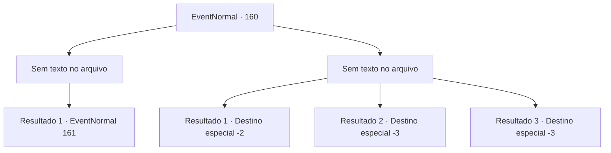

# Eventos normais · 160

[Índice da tabela](index.md) · [Índice geral](../index.md)

ID: `pt:EventNormal:160` · Fonte: `EventNormal4` · Versão: 1.2.47.

Mapeamento estático dos arquivos; a disponibilidade e a execução dependem do estado da run.

## Texto do evento

*Sem texto no arquivo.*

## Dados de entrada

```json
{
  "id": 160,
  "grade": 1,
  "place": "",
  "required": ""
}
```

## Mapa das escolhas



## Escolhas e resultados

### Escolha 1

*Sem texto no arquivo; o papel dessa opção depende da interface do jogo.*

Requisitos e outros campos da escolha:

```json
{
  "required": ""
}
```

#### Resultado 1.1

Hobgoblins cobrem o chão, mortos ou feridos fatalmente. Seu líder, o xamã goblin, implora com os olhos esbugalhados. 

 "Eu... eu imploro por misericórdia! Isso nunca vai acontecer de novo, eu prometo!"

 Ele pede seu perdão em Língua Comum surpreendentemente fluente.

Continuação registrada: [Evento 161](0161.md) na mesma tabela.

```json
{
  "required": "",
  "chance": "1",
  "nextEvent": 161,
  "type": 2,
  "reward": ""
}
```

### Escolha 2

*Sem texto no arquivo; o papel dessa opção depende da interface do jogo.*

Requisitos e outros campos da escolha:

```json
{
  "required": ""
}
```

#### Resultado 2.1

Você mal consegue escapar dos hobgoblins. Eles perseguem você com suas pernas curtas, mas não conseguem te alcançar.

Continuação registrada: [Destino especial `-2`](../destinos-especiais.md).

```json
{
  "required": "1_0_2|1_1_2",
  "chance": "1",
  "nextEvent": -2,
  "type": 2,
  "reward": "0_0_-1|0_1_-1"
}
```

#### Resultado 2.2

Sua mente se desvanece enquanto os hobgoblins cacarejam maliciosamente.

Continuação registrada: [Destino especial `-3`](../destinos-especiais.md).

```json
{
  "required": "2_0_2",
  "chance": "1",
  "nextEvent": -3,
  "type": 2,
  "reward": "0_0_-1|0_1_-1"
}
```

#### Resultado 2.3

Sua mente se desvanece enquanto os hobgoblins cacarejam maliciosamente.

Continuação registrada: [Destino especial `-3`](../destinos-especiais.md).

```json
{
  "required": "2_1_2",
  "chance": "1",
  "nextEvent": -3,
  "type": 2,
  "reward": "0_0_-1|0_1_-1"
}
```

## Referências que chegam a este evento

- [Evento 159 · escolha 1 · resultado 1](0159.md#escolha-1)
- [Evento 159 · escolha 1 · resultado 3](0159.md#escolha-1)
- [Evento 159 · escolha 2 · resultado 1](0159.md#escolha-2)
- [Evento 159 · escolha 3 · resultado 1](0159.md#escolha-3)
- [Evento 159 · escolha 3 · resultado 3](0159.md#escolha-3)
