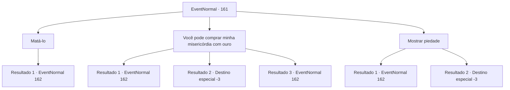

# Eventos normais · 161

[Índice da tabela](index.md) · [Índice geral](../index.md)

ID: `pt:EventNormal:161` · Fonte: `EventNormal4` · Versão: 1.2.47.

Mapeamento estático dos arquivos; a disponibilidade e a execução dependem do estado da run.

## Texto do evento

*Sem texto no arquivo.*

## Dados de entrada

```json
{
  "id": 161,
  "grade": 1,
  "place": "",
  "required": ""
}
```

## Mapa das escolhas



## Escolhas e resultados

### Escolha 1

Matá-lo

Requisitos e outros campos da escolha:

```json
{
  "required": ""
}
```

#### Resultado 1.1

Você usa sua arma no goblin xamã derrotado. Ele pula para trás e sorri. 

 "Hehehe... Humano inteligente, não é?"

 O goblin aponta seu cajado para você.

Continuação registrada: [Evento 162](0162.md) na mesma tabela.

```json
{
  "required": "",
  "chance": "1",
  "nextEvent": 162,
  "type": 2,
  "reward": "6_0_23",
  "place": 1
}
```

### Escolha 2

Você pode comprar minha misericórdia com ouro

Requisitos e outros campos da escolha:

```json
{
  "required": ""
}
```

#### Resultado 2.1

Você pede ouro em troca de misericórdia. 

 "Certo, certo! Tudo bem!"

 O goblin enfia a mão no bolso. Mas sua mão sai segurando um punhal em vez de moedas. O goblin xamã avança e te apunhala no estômago. Então ele pula para trás e sorri. 

 "Hehehe! Humano estúpido! Você pensou mesmo que eu iria me curvar ao seu tipo?"


Continuação registrada: [Evento 162](0162.md) na mesma tabela.

```json
{
  "required": "1_0_2",
  "chance": "14",
  "nextEvent": 162,
  "type": 2,
  "reward": "6_3_23|0_0_-1|0_2_1",
  "place": 1
}
```

#### Resultado 2.2

Você pede ouro em troca de misericórdia. 

 "Certo, certo! Tudo bem!"

 O goblin enfia a mão no bolso. Mas sua mão sai segurando um punhal em vez de moedas. O goblin xamã avança e te apunhala no estômago. Então ele pula para trás e sorri. 

 "Hehehe! Humano estúpido! Eu nunca vou me curvar ao seu tipo!"

 Sua mente se desvanece à medida que você perde sangue rapidamente.

Continuação registrada: [Destino especial `-3`](../destinos-especiais.md).

```json
{
  "required": "2_0_2",
  "chance": "14",
  "nextEvent": -3,
  "type": 2,
  "reward": "0_0_-1"
}
```

#### Resultado 2.3

Você pede ouro em troca de perdão. 

 "Certo, certo! Tudo bem!"

 O goblin enfia a mão no bolso. Mas sua mão sai segurando um punhal em vez de moedas. O goblin xamã avança e tenta te esfaquear no estômago. Mas você se esquiva da lâmina bem na hora. O goblin pula para trás e saca seu cajado. 

 "Hehehe... Humano inteligente, não é?"


Continuação registrada: [Evento 162](0162.md) na mesma tabela.

```json
{
  "required": "",
  "chance": "1|0_6_1",
  "nextEvent": 162,
  "type": 2,
  "reward": "6_0_23|0_2_1",
  "place": 1
}
```

### Escolha 3

Mostrar piedade

Requisitos e outros campos da escolha:

```json
{
  "required": ""
}
```

#### Resultado 3.1

Você decide poupar o goblin xamã. Mas assim que você se vira, você sente uma dor imensa na cintura. Um punhal está saindo dele. 

 "Hehehe! Humano estúpido! Eu nunca vou me curvar ao seu tipo!"

 O goblin xamã pula para trás e saca seu cajado.

Continuação registrada: [Evento 162](0162.md) na mesma tabela.

```json
{
  "required": "1_0_2",
  "chance": "1",
  "nextEvent": 162,
  "type": 2,
  "reward": "6_3_23|0_0_-1|0_3_3|0_2_1",
  "place": 1
}
```

#### Resultado 3.2

Você decide poupar o goblin xamã. Mas assim que você se vira, você sente uma dor imensa na cintura. Um punhal está saindo dele. 

 "Hehehe! Humano estúpido! Eu nunca vou me curvar ao seu tipo!"

 Sua mente se desvanece à medida que você perde sangue rapidamente.

Continuação registrada: [Destino especial `-3`](../destinos-especiais.md).

```json
{
  "required": "2_0_2",
  "chance": "1",
  "nextEvent": -3,
  "type": 2,
  "reward": "0_0_-1|0_3_3"
}
```

## Referências que chegam a este evento

- [Evento 160 · escolha 1 · resultado 1](0160.md#escolha-1)
