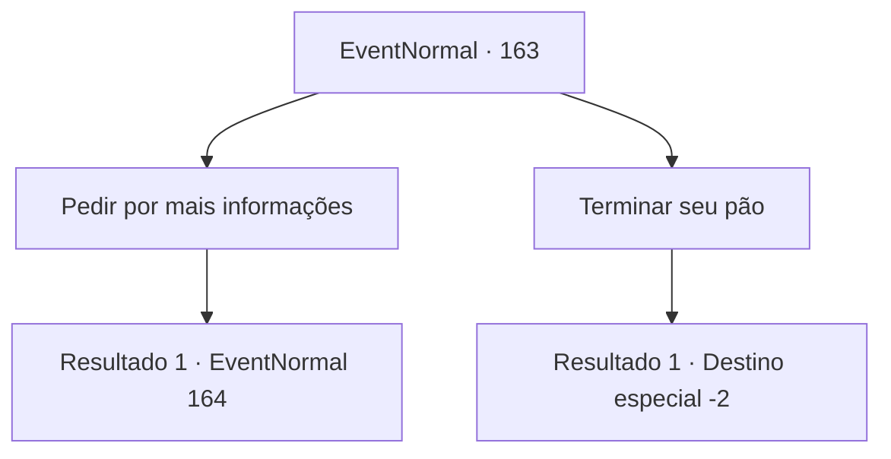

# Eventos normais · 163

[Índice da tabela](index.md) · [Índice geral](../index.md)

ID: `pt:EventNormal:163` · Fonte: `EventNormal4` · Versão: 1.2.47.

Mapeamento estático dos arquivos; a disponibilidade e a execução dependem do estado da run.

## Texto do evento

Você passa por uma pequena cidade chamada Geherin para comprar um pouco de comida. Você compra um pão duro e se senta em um banco para mordiscá-lo. Então você ouve uma conversa entre dois homens. 

 "Você ouviu sobre a Bruxa da Juventude? Ela mora nos pântanos de Alengr e pode ficar mais jovem."

 "Bobagem... Todo mundo envelhece, rapaz. Não o contrário."

 "Não, estou te dizendo, Joel viu uma velha que se transformou em uma menina em um instante!"

 Você levanta a cabeça para encará-los.

## Dados de entrada

```json
{
  "id": 163,
  "grade": 1,
  "place": "",
  "required": "5_117_0"
}
```

## Mapa das escolhas



## Escolhas e resultados

### Escolha 1

Pedir por mais informações

Requisitos e outros campos da escolha:

```json
{
  "required": ""
}
```

#### Resultado 1.1

A conversa deles te intriga. Você pede mais informações e um deles cruza os braços. 

 "Hmm... eu poderia dizer mais dependendo do que você está disposto a oferecer."


Continuação registrada: [Evento 164](0164.md) na mesma tabela.

```json
{
  "required": "",
  "chance": "1",
  "nextEvent": 164,
  "type": 2,
  "reward": ""
}
```

### Escolha 2

Terminar seu pão

Requisitos e outros campos da escolha:

```json
{
  "required": ""
}
```

#### Resultado 2.1

Você ignora isso como um boato e continua comendo seu pão. Os dois homens conversam por algum tempo antes de sair.

Continuação registrada: [Destino especial `-2`](../destinos-especiais.md).

```json
{
  "required": "",
  "chance": "1",
  "nextEvent": -2,
  "type": 2,
  "reward": "5_117_9"
}
```

## Referências que chegam a este evento

Nenhum `nextEvent` positivo da mesma tabela aponta para este nó. Isso não prova que seja inacessível: sorteio e estado de história podem selecioná-lo.

