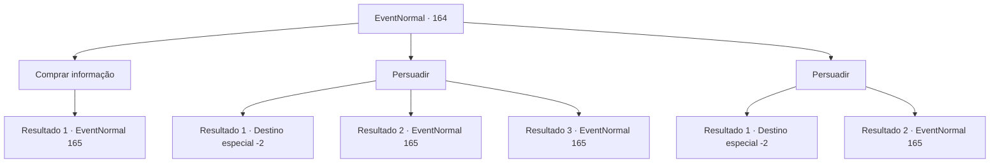

# Eventos normais · 164

[Índice da tabela](index.md) · [Índice geral](../index.md)

ID: `pt:EventNormal:164` · Fonte: `EventNormal4` · Versão: 1.2.47.

Mapeamento estático dos arquivos; a disponibilidade e a execução dependem do estado da run.

## Texto do evento

*Sem texto no arquivo.*

## Dados de entrada

```json
{
  "id": 164,
  "grade": 1,
  "place": "",
  "required": ""
}
```

## Mapa das escolhas



## Escolhas e resultados

### Escolha 1

Comprar informação

Requisitos e outros campos da escolha:

```json
{
  "required": "1_4_50"
}
```

#### Resultado 1.1

Você oferece ouro ao homem para obter mais informações. Ele pega as moedas e sorri. 

 "Ah sim, um homem de cultura. Muito bem. Então... de acordo com meu amigo Joel..."

 Segundo ele, Joel viu a bruxa engolir uma espécie de pedrinha depois que ela girou e girou até se transformar em uma jovem garota. O outro homem interrompe, exasperado. 

 "Qual é, isso é ridículo. Por que você não vai descobrir para nós se é verdade? A cidade inteira está ficando inquieta."


Continuação registrada: [Evento 165](0165.md) na mesma tabela.

```json
{
  "required": "",
  "chance": "1",
  "nextEvent": 165,
  "type": 2,
  "reward": "0_4_-50|0_2_1"
}
```

### Escolha 2

Persuadir

Requisitos e outros campos da escolha:

```json
{
  "required": ""
}
```

#### Resultado 2.1

Você mostra sua cara de negócios e educadamente pede suas informações. 

 "Que cara mais louco. Vamos lá."

 Eles bufam e se afastam de você.

Continuação registrada: [Destino especial `-2`](../destinos-especiais.md).

```json
{
  "required": "",
  "chance": "12",
  "nextEvent": -2,
  "type": 1,
  "reward": "5_117_9"
}
```

#### Resultado 2.2

Você mostra sua cara de negócios e educadamente pede suas informações. Eles se soltam e dizem o que sabem. De acordo com um dos homens, diz-se que a bruxa engole algum tipo de pedrinha o que a faz girar e girar até se transformar em uma jovem. O outro homem interrompe, exasperado. 

 "Qual é, isso é ridículo. Por que você não vai descobrir para nós se é verdade? A cidade inteira está ficando inquieta."


Continuação registrada: [Evento 165](0165.md) na mesma tabela.

```json
{
  "required": "",
  "chance": "1|0_12_1",
  "nextEvent": 165,
  "type": 0,
  "reward": ""
}
```

#### Resultado 2.3

Você mostra sua cara de negócios e educadamente pede suas informações. Eles se soltam e dizem o que sabem. De acordo com um dos homens, diz-se que a bruxa engole algum tipo de pedrinha o que a faz girar e girar até se transformar em uma jovem. O outro homem interrompe, exasperado. 

 "Qual é, isso é ridículo. Por que você não vai descobrir para nós se é verdade? A cidade inteira está ficando inquieta."


Continuação registrada: [Evento 165](0165.md) na mesma tabela.

```json
{
  "required": "20_4_1",
  "chance": "1|0_12_1",
  "nextEvent": 165,
  "type": 0,
  "reward": ""
}
```

### Escolha 3

Persuadir

Requisitos e outros campos da escolha:

```json
{
  "required": ""
}
```

#### Resultado 3.1

Você tenta persuadi-los, mas eles não estão dispostos a ouvir. Os dois homens conversam exclusivamente um com o outro antes de se levantar e sair.

Continuação registrada: [Destino especial `-2`](../destinos-especiais.md).

```json
{
  "required": "",
  "chance": "10",
  "nextEvent": -2,
  "type": 1,
  "reward": "5_117_9"
}
```

#### Resultado 3.2

Você os convence com sucesso com sua inteligência. Um dos homens acena com a cabeça e começa a falar. 

 "Certo. Então, de acordo com meu amigo Joel..."

 Segundo ele, Joel viu a bruxa engolir uma espécie de pedrinha depois que ela girou e girou até se transformar em uma jovem garota. O outro homem interrompe, exasperado. 

 "Qual é, isso é ridículo. Por que você não vai descobrir para nós se é verdade? A cidade inteira está ficando inquieta."


Continuação registrada: [Evento 165](0165.md) na mesma tabela.

```json
{
  "required": "",
  "chance": "1|0_7_1",
  "nextEvent": 165,
  "type": 0,
  "reward": ""
}
```

## Referências que chegam a este evento

- [Evento 163 · escolha 1 · resultado 1](0163.md#escolha-1)
