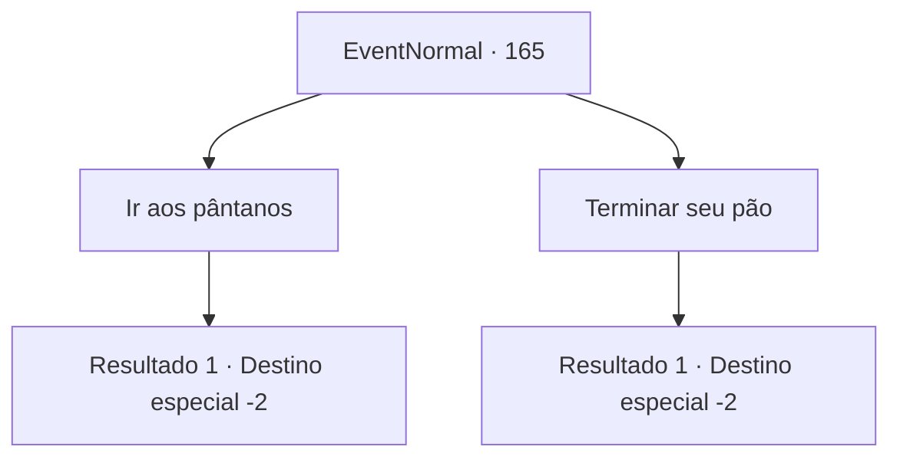

# Eventos normais · 165

[Índice da tabela](index.md) · [Índice geral](../index.md)

ID: `pt:EventNormal:165` · Fonte: `EventNormal4` · Versão: 1.2.47.

Mapeamento estático dos arquivos; a disponibilidade e a execução dependem do estado da run.

## Texto do evento

*Sem texto no arquivo.*

## Dados de entrada

```json
{
  "id": 165,
  "grade": 1,
  "place": "",
  "required": ""
}
```

## Mapa das escolhas



## Escolhas e resultados

### Escolha 1

Ir aos pântanos

Requisitos e outros campos da escolha:

```json
{
  "required": ""
}
```

#### Resultado 1.1

Você decide ir procurar a bruxa nos pântanos. De acordo com os dois homens, você precisa seguir a Estrela do Norte para chegar ao local dela.

Continuação registrada: [Destino especial `-2`](../destinos-especiais.md).

```json
{
  "required": "",
  "chance": "1",
  "nextEvent": -2,
  "type": 2,
  "reward": "5_117_1"
}
```

### Escolha 2

Terminar seu pão

Requisitos e outros campos da escolha:

```json
{
  "required": ""
}
```

#### Resultado 2.1

Você ignora isso como um boato e continua comendo seu pão. Os dois homens conversam por algum tempo antes de sair.

Continuação registrada: [Destino especial `-2`](../destinos-especiais.md).

```json
{
  "required": "",
  "chance": "1",
  "nextEvent": -2,
  "type": 2,
  "reward": "5_117_9"
}
```

## Referências que chegam a este evento

- [Evento 164 · escolha 1 · resultado 1](0164.md#escolha-1)
- [Evento 164 · escolha 2 · resultado 2](0164.md#escolha-2)
- [Evento 164 · escolha 2 · resultado 3](0164.md#escolha-2)
- [Evento 164 · escolha 3 · resultado 2](0164.md#escolha-3)
