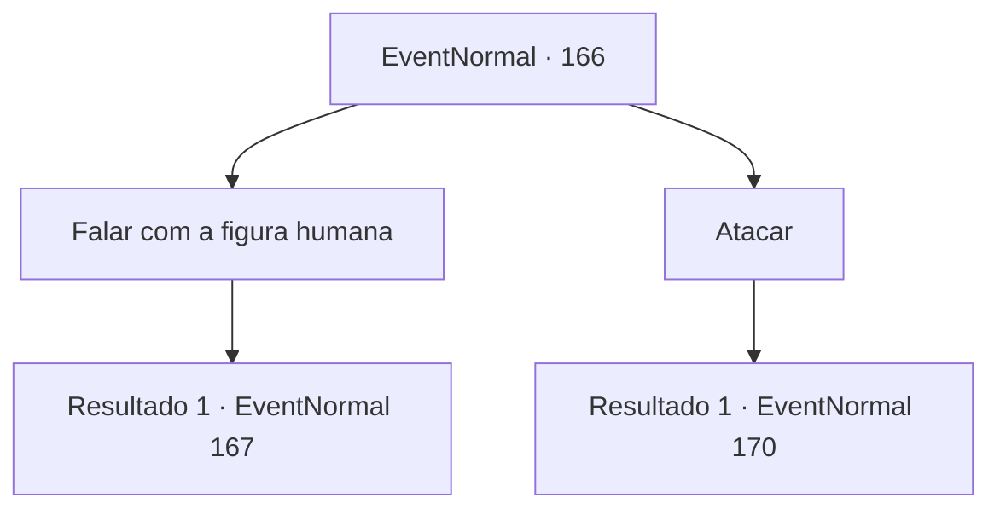

# Eventos normais · 166

[Índice da tabela](index.md) · [Índice geral](../index.md)

ID: `pt:EventNormal:166` · Fonte: `EventNormal4` · Versão: 1.2.47.

Mapeamento estático dos arquivos; a disponibilidade e a execução dependem do estado da run.

## Texto do evento

|drawing_swarpForest| Você depende das estrelas para navegar enquanto caminha pelos pântanos. As árvores parecem inclinadas, como se dissessem que não gostam de você. De repente, você avista uma figura humana por entre os galhos. Ele usa um manto cinza, curvado sobre uma erva no chão.

## Dados de entrada

```json
{
  "id": 166,
  "grade": 2,
  "place": "",
  "required": "5_117_1"
}
```

## Mapa das escolhas



## Escolhas e resultados

### Escolha 1

Falar com a figura humana

Requisitos e outros campos da escolha:

```json
{
  "required": ""
}
```

#### Resultado 1.1

Você fala com a figura vestida. Ela lentamente se levanta e tira o capuz para revelar um rosto. Era uma mulher de cerca de 60 anos, e tão alta quanto um homem adulto. 

 "O que traz um aventureiro como você, criança, a uma velhinha como eu?"

 Você pergunta sobre os rumores que ouviu na cidade. Ela gargalha e responde. 

 "Heehehee! Bruxa da Juventude, é? Gostei do apelido. Sim, eu faço poções da juventude. Elas são um produto do meu projeto de vida. Uma dose me mantém 10 anos mais jovem por um mês, duas doses me mantém 30 anos mais jovem por seis..."

 Ela faz uma pausa antes de continuar. 

 "E três doses tiram 50 anos da minha idade por um ano inteiro."


Continuação registrada: [Evento 167](0167.md) na mesma tabela.

```json
{
  "required": "",
  "chance": "1",
  "nextEvent": 167,
  "type": 2,
  "reward": ""
}
```

### Escolha 2

Atacar

Requisitos e outros campos da escolha:

```json
{
  "required": ""
}
```

#### Resultado 2.1

Você ataca a figura vestida. Ela cai no chão, mal conseguindo se esquivar de seu ataque. O manto sai para revelar uma jovem garota e uma anciã. A menina tem orelhas pontudas e um rosto bonito, presumivelmente um espírito da floresta, também conhecido como ninfa. A anciã parece ser um gnomo, a julgar por sua baixa estatura e cabelos grossos. A ninfa estende a mão com raiva, produzindo um orbe mágico de seus dedos.

Continuação registrada: [Evento 170](0170.md) na mesma tabela.

```json
{
  "required": "",
  "chance": "1",
  "nextEvent": 170,
  "type": 2,
  "reward": "6_0_32",
  "place": 1
}
```

## Referências que chegam a este evento

Nenhum `nextEvent` positivo da mesma tabela aponta para este nó. Isso não prova que seja inacessível: sorteio e estado de história podem selecioná-lo.

