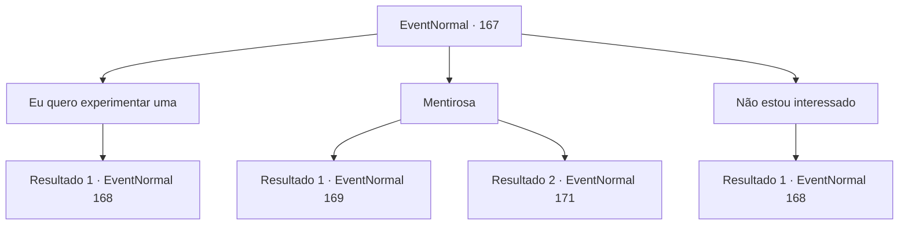

# Eventos normais · 167

[Índice da tabela](index.md) · [Índice geral](../index.md)

ID: `pt:EventNormal:167` · Fonte: `EventNormal4` · Versão: 1.2.47.

Mapeamento estático dos arquivos; a disponibilidade e a execução dependem do estado da run.

## Texto do evento

*Sem texto no arquivo.*

## Dados de entrada

```json
{
  "id": 167,
  "grade": 1,
  "place": "",
  "required": ""
}
```

## Mapa das escolhas



## Escolhas e resultados

### Escolha 1

Eu quero experimentar uma

Requisitos e outros campos da escolha:

```json
{
  "required": ""
}
```

#### Resultado 1.1

Você pede a poção mágica dela. Seu rosto se enruga em um sorriso agradável. 

 "Hehe... eu gosto desse espírito jovem."

 Ela enfia a mão nos bolsos e tira uma pequena pedrinha verde. Ela o rola na palma da mão enquanto fala. 

 "Claro, não é grátis. São 400 moedas de ouro a garrafa. Só aceito pagamentos adiantados."


Continuação registrada: [Evento 168](0168.md) na mesma tabela.

```json
{
  "required": "",
  "chance": "1",
  "nextEvent": 168,
  "type": 2,
  "reward": ""
}
```

### Escolha 2

Mentirosa

Requisitos e outros campos da escolha:

```json
{
  "required": "1_14_11"
}
```

#### Resultado 2.1

Você observa as expressões faciais dela e percebe que ela está mentindo. Você a interrompe agressivamente, fazendo que ela fique em silêncio e tira uma pedrinha verde de seus bolsos. Então ela come. Ela franze a testa de dor enquanto cai no chão. Algo se mexe sob seu roupão cinza. Quando ela se levanta novamente, seu rosto é o de uma adolescente. Ela fala com você com uma voz calma e agradável. 

 "Phew... Que tal? Acredita em mim agora?"


Continuação registrada: [Evento 169](0169.md) na mesma tabela.

```json
{
  "required": "10_93_1",
  "chance": "1",
  "nextEvent": 169,
  "type": 2,
  "reward": ""
}
```

#### Resultado 2.2

Você observa as expressões faciais dela e percebe que ela está mentindo. Então você colocou 'a Respondente' no pescoço do velho e gritou para ele dizer de novo. Você pergunta agressivamente, e o velho gnomo responde com a voz trêmula. <link=shake>

 "S-sim... Não há poção da juventude..."

</link> Ela faz uma pausa antes de continuar com uma voz mais firme. 

 "Mas esta poção te deixa mais saudável. Vale pelo menos 300 moedas de ouro..."

 Ela para e olha cautelosamente para você de lado. Então ela abre a boca novamente. 

 "Você... por favor, manteria isso em segredo se eu lhe der esta poção de graça?"


Continuação registrada: [Evento 171](0171.md) na mesma tabela.

```json
{
  "required": "8_93_1",
  "chance": "1",
  "nextEvent": 171,
  "type": 2,
  "reward": "5_116_3"
}
```

### Escolha 3

Não estou interessado

Requisitos e outros campos da escolha:

```json
{
  "required": ""
}
```

#### Resultado 3.1

Você percebe que ela é uma herbalista e não uma bruxa, e perde o interesse em sua poção, já que tudo que você precisa fazer é voltar para a cidade e completar seu contrato. Quando você se vira, ela desesperadamente agarra seu braço. 

 "Eu... quer dizer... é uma poção da juventude e você não está nem um pouco interessado? São apenas 400 moedas de ouro por uma garrafa."


Continuação registrada: [Evento 168](0168.md) na mesma tabela.

```json
{
  "required": "",
  "chance": "1",
  "nextEvent": 168,
  "type": 2,
  "reward": ""
}
```

## Referências que chegam a este evento

- [Evento 166 · escolha 1 · resultado 1](0166.md#escolha-1)
