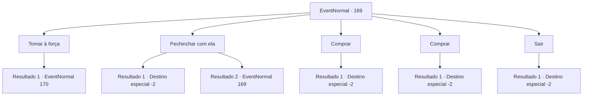

# Eventos normais · 169

[Índice da tabela](index.md) · [Índice geral](../index.md)

ID: `pt:EventNormal:169` · Fonte: `EventNormal4` · Versão: 1.2.47.

Mapeamento estático dos arquivos; a disponibilidade e a execução dependem do estado da run.

## Texto do evento

*Sem texto no arquivo.*

## Dados de entrada

```json
{
  "id": 169,
  "grade": 1,
  "place": "",
  "required": ""
}
```

## Mapa das escolhas



## Escolhas e resultados

### Escolha 1

Tomar à força

Requisitos e outros campos da escolha:

```json
{
  "required": ""
}
```

#### Resultado 1.1

Você decide tomar a poção da juventude à força. Você balança sua arma e a mulher cai no chão para se esquivar. O manto sai para revelar uma jovem e uma velha. A menina tem orelhas pontudas e um rosto bonito, presumivelmente um espírito da floresta, também conhecido como ninfa. A velha parece ser um gnomo, a julgar por sua baixa estatura e cabelos grossos. A ninfa estende a mão com raiva, produzindo um orbe mágico de seus dedos.

Continuação registrada: [Evento 170](0170.md) na mesma tabela.

```json
{
  "required": "",
  "chance": "1",
  "nextEvent": 170,
  "type": 2,
  "reward": "6_0_32",
  "place": 1
}
```

### Escolha 2

Pechinchar com ela

Requisitos e outros campos da escolha:

```json
{
  "required": "5_116_0"
}
```

#### Resultado 2.1

Você tenta negociar com a velha. Ela bufa e recusa. 

 "Hmph. Não a esse preço que você não!"

 Ela faz as malas e vai embora.

Continuação registrada: [Destino especial `-2`](../destinos-especiais.md).

```json
{
  "required": "",
  "chance": "14",
  "nextEvent": -2,
  "type": 1,
  "reward": "5_117_9"
}
```

#### Resultado 2.2

Você tenta barganhar com a velha Ela olha em seus olhos por um tempo antes de assentir. 

 "Claro... 300 a garrafa!"


Continuação registrada: [Evento 169](0169.md) na mesma tabela.

```json
{
  "required": "",
  "chance": "1|0_12_1",
  "nextEvent": 169,
  "type": 0,
  "reward": "5_116_1"
}
```

### Escolha 3

Comprar

Requisitos e outros campos da escolha:

```json
{
  "required": "1_4_400|18_116_1"
}
```

#### Resultado 3.1

Você compra uma garrafa de poção da juventude da velha. Ela sorri agradavelmente e lhe entrega o mármore verde. Então ela faz as malas e vai embora. Você embolsa a bola de gude e volta para Geherin.

Continuação registrada: [Destino especial `-2`](../destinos-especiais.md).

```json
{
  "required": "",
  "chance": "1",
  "nextEvent": -2,
  "type": 2,
  "reward": "0_4_-400|3_151_1|5_117_2|0_2_1"
}
```

### Escolha 4

Comprar

Requisitos e outros campos da escolha:

```json
{
  "required": "1_4_300|5_116_1"
}
```

#### Resultado 4.1

Você compra uma garrafa de poção da juventude da velha. Ela sorri agradavelmente e lhe entrega o mármore verde. Então ela faz as malas e vai embora. Você embolsa a bola de gude e volta para Geherin.

Continuação registrada: [Destino especial `-2`](../destinos-especiais.md).

```json
{
  "required": "",
  "chance": "1",
  "nextEvent": -2,
  "type": 2,
  "reward": "0_4_-300|3_151_1|5_117_2|0_2_1"
}
```

### Escolha 5

Sair

Requisitos e outros campos da escolha:

```json
{
  "required": ""
}
```

#### Resultado 5.1

Você não compra nada da velha e voltar. Ela resmunga um pouco de decepção.

Continuação registrada: [Destino especial `-2`](../destinos-especiais.md).

```json
{
  "required": "",
  "chance": "1",
  "nextEvent": -2,
  "type": 2,
  "reward": "5_117_9"
}
```

## Referências que chegam a este evento

- [Evento 167 · escolha 2 · resultado 1](0167.md#escolha-2)
- [Evento 169 · escolha 2 · resultado 2](0169.md#escolha-2)
