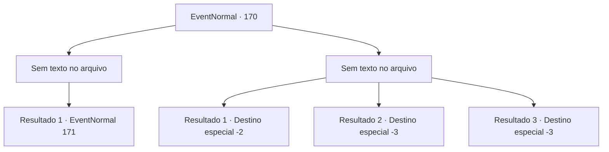

# Eventos normais · 170

[Índice da tabela](index.md) · [Índice geral](../index.md)

ID: `pt:EventNormal:170` · Fonte: `EventNormal4` · Versão: 1.2.47.

Mapeamento estático dos arquivos; a disponibilidade e a execução dependem do estado da run.

## Texto do evento

*Sem texto no arquivo.*

## Dados de entrada

```json
{
  "id": 170,
  "grade": 1,
  "place": "",
  "required": ""
}
```

## Mapa das escolhas



## Escolhas e resultados

### Escolha 1

*Sem texto no arquivo; o papel dessa opção depende da interface do jogo.*

Requisitos e outros campos da escolha:

```json
{
  "required": ""
}
```

#### Resultado 1.1

Você derrota a ninfa. Ela cai no chão e é reduzida a cinzas. O velho gnomo treme de terror. 

 "Por que... por que você faria isso? O que fizemos de tão errado...?"


Continuação registrada: [Evento 171](0171.md) na mesma tabela.

```json
{
  "required": "",
  "chance": "1",
  "nextEvent": 171,
  "type": 2,
  "reward": "5_116_2"
}
```

### Escolha 2

*Sem texto no arquivo; o papel dessa opção depende da interface do jogo.*

Requisitos e outros campos da escolha:

```json
{
  "required": ""
}
```

#### Resultado 2.1

A ninfa bate em você e você mal escapa dos pântanos. Mas desde que você descobriu a verdade, você decide voltar para Geherin e avisá-los.

Continuação registrada: [Destino especial `-2`](../destinos-especiais.md).

```json
{
  "required": "1_0_2|1_1_2",
  "chance": "1",
  "nextEvent": -2,
  "type": 2,
  "reward": "0_0_-1|0_1_-1|5_116_2|5_117_2|0_2_1"
}
```

#### Resultado 2.2

A ninfa do pântano tira sua vida.

Continuação registrada: [Destino especial `-3`](../destinos-especiais.md).

```json
{
  "required": "2_0_2",
  "chance": "1",
  "nextEvent": -3,
  "type": 2,
  "reward": "0_0_-1|0_1_-1"
}
```

#### Resultado 2.3

A ninfa do pântano tira sua vida.

Continuação registrada: [Destino especial `-3`](../destinos-especiais.md).

```json
{
  "required": "2_1_2",
  "chance": "1",
  "nextEvent": -3,
  "type": 2,
  "reward": "0_0_-1|0_1_-1"
}
```

## Referências que chegam a este evento

- [Evento 166 · escolha 2 · resultado 1](0166.md#escolha-2)
- [Evento 168 · escolha 1 · resultado 1](0168.md#escolha-1)
- [Evento 169 · escolha 1 · resultado 1](0169.md#escolha-1)
