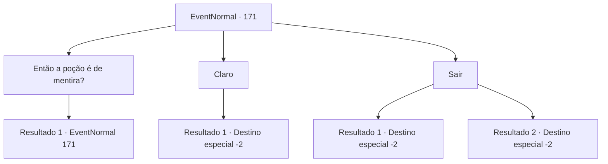

# Eventos normais · 171

[Índice da tabela](index.md) · [Índice geral](../index.md)

ID: `pt:EventNormal:171` · Fonte: `EventNormal4` · Versão: 1.2.47.

Mapeamento estático dos arquivos; a disponibilidade e a execução dependem do estado da run.

## Texto do evento

*Sem texto no arquivo.*

## Dados de entrada

```json
{
  "id": 171,
  "grade": 1,
  "place": "",
  "required": ""
}
```

## Mapa das escolhas



## Escolhas e resultados

### Escolha 1

Então a poção é de mentira?

Requisitos e outros campos da escolha:

```json
{
  "required": "18_116_3"
}
```

#### Resultado 1.1

Você pergunta agressivamente, e o velho gnomo responde com a voz trêmula. <link=shake>

 "S-sim... Não há poção da juventude..."

</link> Ela faz uma pausa antes de continuar com uma voz mais firme. 

 "Mas esta poção te deixa mais saudável. Vale bem 300 de ouro..."

 Ela para e olha cautelosamente para você de lado. Então ela abre a boca novamente. 

 "Você... por favor, mantenha isso em segredo se eu lhe der esta poção de graça?"


Continuação registrada: [Evento 171](0171.md) na mesma tabela.

```json
{
  "required": "",
  "chance": "1",
  "nextEvent": 171,
  "type": 2,
  "reward": "5_116_3"
}
```

### Escolha 2

Claro

Requisitos e outros campos da escolha:

```json
{
  "required": "5_116_3"
}
```

#### Resultado 2.1

Você aceita as condições dela. Ela acena com a cabeça e lhe entrega a bolinha de gude verde. Ela implora que você mantenha seu segredo. Você embolsa a bola de gude e volta para Geherin.

Continuação registrada: [Destino especial `-2`](../destinos-especiais.md).

```json
{
  "required": "",
  "chance": "1",
  "nextEvent": -2,
  "type": 2,
  "reward": "5_117_2|3_151_1|0_2_1"
}
```

### Escolha 3

Sair

Requisitos e outros campos da escolha:

```json
{
  "required": ""
}
```

#### Resultado 3.1

Você volta sem uma palavra. Ela tenta dizer algo antes de decidir que não vai. Desde que você descobriu a verdade, você decide voltar para Geherin e espalhá-lo.

Continuação registrada: [Destino especial `-2`](../destinos-especiais.md).

```json
{
  "required": "18_116_3",
  "chance": "1",
  "nextEvent": -2,
  "type": 2,
  "reward": "5_117_2"
}
```

#### Resultado 3.2

Você não responde à proposta dela. Você volta sem uma palavra e volta para Geherin.

Continuação registrada: [Destino especial `-2`](../destinos-especiais.md).

```json
{
  "required": "5_116_3",
  "chance": "1",
  "nextEvent": -2,
  "type": 2,
  "reward": "5_117_2"
}
```

## Referências que chegam a este evento

- [Evento 167 · escolha 2 · resultado 2](0167.md#escolha-2)
- [Evento 170 · escolha 1 · resultado 1](0170.md#escolha-1)
- [Evento 171 · escolha 1 · resultado 1](0171.md#escolha-1)
