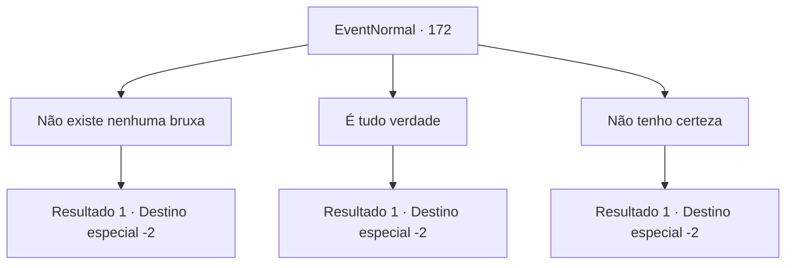

# Eventos normais · 172

[Índice da tabela](index.md) · [Índice geral](../index.md)

ID: `pt:EventNormal:172` · Fonte: `EventNormal4` · Versão: 1.2.47.

Mapeamento estático dos arquivos; a disponibilidade e a execução dependem do estado da run.

## Texto do evento

Você volta para Geherin. A cidade inteira está começando a aceitar os rumores como fatos. Eles não param de falar sobre a Bruxa da Juventude. Enquanto você examina as ruas, os dois homens que te contrataram se aproximam. 

 "Ah, você está aqui. Como foi? Você encontrou a bruxa? Ela realmente fica mais jovem?"

 "Pela milionésima vez, não existe tal coisa. Todo mundo está louco..."

 

## Dados de entrada

```json
{
  "id": 172,
  "grade": 2,
  "place": "",
  "required": "5_117_2"
}
```

## Mapa das escolhas



## Escolhas e resultados

### Escolha 1

Não existe nenhuma bruxa

Requisitos e outros campos da escolha:

```json
{
  "required": "5_116_2"
}
```

#### Resultado 1.1

Diga aos homens que não há bruxa e explique o que viu. O homem da esquerda torna-se triunfante. 

 "Eu disse que não faz sentido!"

 O outro homem coça a cabeça em decepção e entrega ao amigo algumas moedas. Então ele agradece com o pagamento. 

 "Obrigado por nos avisar."

 Você pega as moedas e continua sua jornada.

Continuação registrada: [Destino especial `-2`](../destinos-especiais.md).

```json
{
  "required": "",
  "chance": "1",
  "nextEvent": -2,
  "type": 2,
  "reward": "0_4_10|0_3_1|5_117_9|0_2_1"
}
```

### Escolha 2

É tudo verdade

Requisitos e outros campos da escolha:

```json
{
  "required": "5_116_3"
}
```

#### Resultado 2.1

Você diz aos homens que os rumores são verdadeiros. O homem à direita torna-se triunfante. 

 "Eu sabia. Joel é um sujeito bom e honesto!"

 O outro homem ainda parece confuso enquanto entrega algumas moedas ao amigo. Então ele agradece com o pagamento. 

 "Obrigada! Eu mesmo irei procurá-la."

 Você pega as moedas e continua sua jornada.

Continuação registrada: [Destino especial `-2`](../destinos-especiais.md).

```json
{
  "required": "",
  "chance": "1",
  "nextEvent": -2,
  "type": 2,
  "reward": "0_4_50|0_3_-3|5_117_9|0_2_1"
}
```

### Escolha 3

Não tenho certeza

Requisitos e outros campos da escolha:

```json
{
  "required": ""
}
```

#### Resultado 3.1

Você diz aos homens que vasculhou os pântanos, mas não conseguiu encontrar nada. O homem da esquerda continua a chamar a coisa toda de mito, enquanto seu amigo permanece fiel à sua crença sobre a bruxa. Você deixa os homens discutindo para trás e continua sua jornada.

Continuação registrada: [Destino especial `-2`](../destinos-especiais.md).

```json
{
  "required": "",
  "chance": "1",
  "nextEvent": -2,
  "type": 2,
  "reward": "5_117_9"
}
```

## Referências que chegam a este evento

Nenhum `nextEvent` positivo da mesma tabela aponta para este nó. Isso não prova que seja inacessível: sorteio e estado de história podem selecioná-lo.

