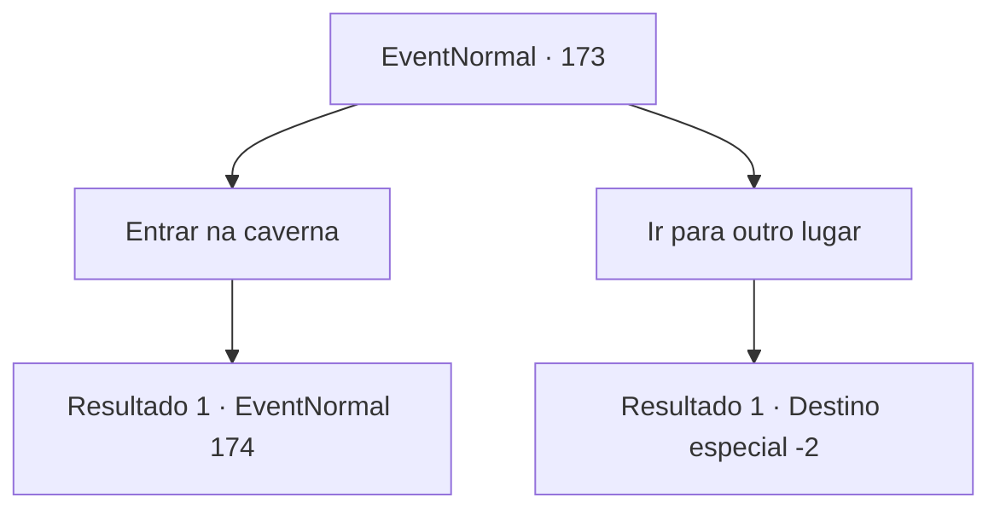

# Eventos normais · 173

[Índice da tabela](index.md) · [Índice geral](../index.md)

ID: `pt:EventNormal:173` · Fonte: `EventNormal4` · Versão: 1.2.47.

Mapeamento estático dos arquivos; a disponibilidade e a execução dependem do estado da run.

## Texto do evento

Você encontra uma entrada para uma caverna em uma densa floresta de madeira macia. Está cheio de pequenos ossos, e você nota os restos de uma fogueira. De repente, alguém grita de dentro da caverna. 

## Dados de entrada

```json
{
  "id": 173,
  "grade": 1,
  "place": "",
  "required": "1_2_10"
}
```

## Mapa das escolhas



## Escolhas e resultados

### Escolha 1

Entrar na caverna

Requisitos e outros campos da escolha:

```json
{
  "required": ""
}
```

#### Resultado 1.1

Você segue os gritos para dentro da caverna. É uma caverna de calcário forrada de estalactites e estalagmites. Gotas frias e opacas de água caem no chão. 

 Depois de algum tempo, você alcança uma pequena criatura humanóide gritando. É o que as pessoas chamam de Derro. Um monstro de cabelos brancos, barba branca e pele acinzentada. Ele olha para você com seus olhos brancos e manchados e grita 

 "Khehehehe! Coma isso!"

 e mostra seu fundo manchado para você peidar. Então ele ri histericamente enquanto corre mais fundo na caverna.

Continuação registrada: [Evento 174](0174.md) na mesma tabela.

```json
{
  "required": "",
  "chance": "1",
  "nextEvent": 174,
  "type": 2,
  "reward": ""
}
```

### Escolha 2

Ir para outro lugar

Requisitos e outros campos da escolha:

```json
{
  "required": ""
}
```

#### Resultado 2.1

Você ignora os gritos e voltar.

Continuação registrada: [Destino especial `-2`](../destinos-especiais.md).

```json
{
  "required": "",
  "chance": "1",
  "nextEvent": -2,
  "type": 2,
  "reward": ""
}
```

## Referências que chegam a este evento

Nenhum `nextEvent` positivo da mesma tabela aponta para este nó. Isso não prova que seja inacessível: sorteio e estado de história podem selecioná-lo.

