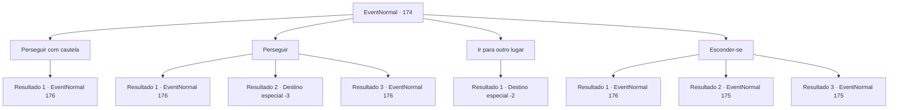

# Eventos normais · 174

[Índice da tabela](index.md) · [Índice geral](../index.md)

ID: `pt:EventNormal:174` · Fonte: `EventNormal4` · Versão: 1.2.47.

Mapeamento estático dos arquivos; a disponibilidade e a execução dependem do estado da run.

## Texto do evento

*Sem texto no arquivo.*

## Dados de entrada

```json
{
  "id": 174,
  "grade": 1,
  "place": "",
  "required": ""
}
```

## Mapa das escolhas



## Escolhas e resultados

### Escolha 1

Perseguir com cautela

Requisitos e outros campos da escolha:

```json
{
  "required": "1_14_11"
}
```

#### Resultado 1.1

Você calmamente persegue o Derro, procurando possíveis emboscadas. Logo, uma estalactite gigante cai sobre sua cabeça. Já tendo antecipado uma armadilha, você se esquiva com facilidade. 

 "Humano desonesto, desonesto! Keehehehehergh!"

 O Derro coça e torce a própria cabeça. Então ele puxa uma adaga e a aponta para você.

Continuação registrada: [Evento 176](0176.md) na mesma tabela.

```json
{
  "required": "",
  "chance": "1",
  "nextEvent": 176,
  "type": 2,
  "reward": "6_0_33",
  "place": 6
}
```

### Escolha 2

Perseguir

Requisitos e outros campos da escolha:

```json
{
  "required": ""
}
```

#### Resultado 2.1

Você persegue o Derro mais fundo na caverna. De repente, uma estalactite gigante cai sobre sua cabeça. Você vê, mas não consegue evitá-lo. O calcário se quebra, mas você também. 

 "Keeehehehehergh! Seu idiota! Idiota!"

 O Derro vaia e ri com uma voz desonesta. Então ele puxa uma adaga e a aponta para você.

Continuação registrada: [Evento 176](0176.md) na mesma tabela.

```json
{
  "required": "1_0_2",
  "chance": "11",
  "nextEvent": 176,
  "type": 1,
  "reward": "6_0_33|0_0_-1",
  "place": 6
}
```

#### Resultado 2.2

Você persegue o Derro mais fundo na caverna. De repente, uma estalactite gigante cai sobre sua cabeça. Você vê, mas não consegue evitá-lo. O calcário esmaga você e tira sua vida.

Continuação registrada: [Destino especial `-3`](../destinos-especiais.md).

```json
{
  "required": "2_0_2",
  "chance": "11",
  "nextEvent": -3,
  "type": 1,
  "reward": "0_0_-1"
}
```

#### Resultado 2.3

Você persegue o Derro mais fundo na caverna. De repente, uma estalactite gigante cai acima de sua cabeça. Você é rápido o suficiente para evitá-lo. O calcário se quebra em pedaços contra o chão da caverna. 

 "Humano desonesto, desonesto! Keehehehehergh!"

 O Derro coça e torce a própria cabeça. Então ele puxa uma adaga e a aponta para você.

Continuação registrada: [Evento 176](0176.md) na mesma tabela.

```json
{
  "required": "",
  "chance": "1|0_6_1",
  "nextEvent": 176,
  "type": 0,
  "reward": "6_0_33",
  "place": 6
}
```

### Escolha 3

Ir para outro lugar

Requisitos e outros campos da escolha:

```json
{
  "required": "1_1_2"
}
```

#### Resultado 3.1

Você decide ignorar a criatura bizarra e sair da caverna.

Continuação registrada: [Destino especial `-2`](../destinos-especiais.md).

```json
{
  "required": "",
  "chance": "1",
  "nextEvent": -2,
  "type": 2,
  "reward": ""
}
```

### Escolha 4

Esconder-se

Requisitos e outros campos da escolha:

```json
{
  "required": ""
}
```

#### Resultado 4.1

Você se esconde atrás de uma estalagmite. O Derro para de correr e começa a procurar por você. Seus olhos quase cegos olham diretamente para você enquanto ele explode em gargalhadas. 

 "Kiehehe! Eu te vejo!"

 Então ele puxa uma adaga e vem atacando.

Continuação registrada: [Evento 176](0176.md) na mesma tabela.

```json
{
  "required": "",
  "chance": "15",
  "nextEvent": 176,
  "type": 1,
  "reward": "6_0_33",
  "place": 6
}
```

#### Resultado 4.2

Você se esconde no escuro. O Derro para de correr e começa a procurar por você. Mas não pode vê-lo.

Continuação registrada: [Evento 175](0175.md) na mesma tabela.

```json
{
  "required": "21_5_1",
  "chance": "1|0_7_1",
  "nextEvent": 175,
  "type": 0,
  "reward": ""
}
```

#### Resultado 4.3

Você se esconde no escuro usando suas habilidades de furtividade excepcionais. O Derro para de correr e começa a procurar por você. Mas não pode vê-lo.

Continuação registrada: [Evento 175](0175.md) na mesma tabela.

```json
{
  "required": "20_5_1",
  "chance": "1|0_7_2",
  "nextEvent": 175,
  "type": 0,
  "reward": ""
}
```

## Referências que chegam a este evento

- [Evento 173 · escolha 1 · resultado 1](0173.md#escolha-1)
