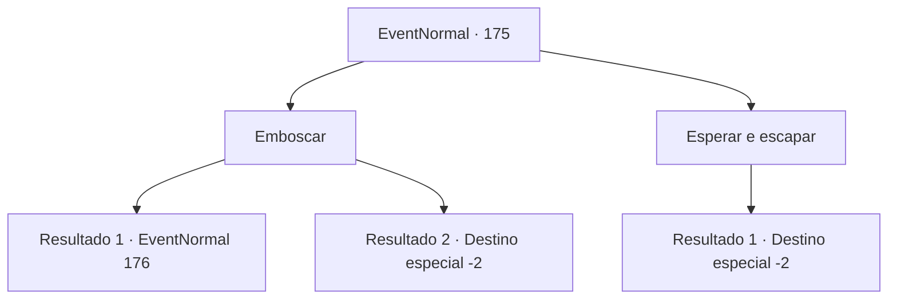

# Eventos normais · 175

[Índice da tabela](index.md) · [Índice geral](../index.md)

ID: `pt:EventNormal:175` · Fonte: `EventNormal4` · Versão: 1.2.47.

Mapeamento estático dos arquivos; a disponibilidade e a execução dependem do estado da run.

## Texto do evento

*Sem texto no arquivo.*

## Dados de entrada

```json
{
  "id": 175,
  "grade": 1,
  "place": "",
  "required": ""
}
```

## Mapa das escolhas



## Escolhas e resultados

### Escolha 1

Emboscar

Requisitos e outros campos da escolha:

```json
{
  "required": ""
}
```

#### Resultado 1.1

Você espera silenciosamente pelo momento certo no escuro. O Derro passa descuidadamente por você, e você inflige um ferimento letal que o faz bater e rolar contra o chão. Sangue preto escorrendo de seu corpo, o Derro puxa uma adaga.

Continuação registrada: [Evento 176](0176.md) na mesma tabela.

```json
{
  "required": "",
  "chance": "10",
  "nextEvent": 176,
  "type": 2,
  "reward": "6_2_33",
  "place": 6
}
```

#### Resultado 1.2

Você espera silenciosamente pelo momento certo no escuro. O Derro passa descuidadamente por você, Com um golpe, você consegue tirar sua vida. Você sai da caverna sentindo-se revigorado.

Continuação registrada: [Destino especial `-2`](../destinos-especiais.md).

```json
{
  "required": "",
  "chance": "1|0_5_1",
  "nextEvent": -2,
  "type": 2,
  "reward": "0_1_1|0_2_1"
}
```

### Escolha 2

Esperar e escapar

Requisitos e outros campos da escolha:

```json
{
  "required": ""
}
```

#### Resultado 2.1

Você espera silenciosamente pelo momento certo no escuro. Depois de algum tempo, o Derro resmunga e desaparece nas profundezas da caverna. Certifique-se de que ele se foi para sempre antes de sair da caverna.

Continuação registrada: [Destino especial `-2`](../destinos-especiais.md).

```json
{
  "required": "",
  "chance": "1",
  "nextEvent": -2,
  "type": 2,
  "reward": ""
}
```

## Referências que chegam a este evento

- [Evento 174 · escolha 4 · resultado 2](0174.md#escolha-4)
- [Evento 174 · escolha 4 · resultado 3](0174.md#escolha-4)
