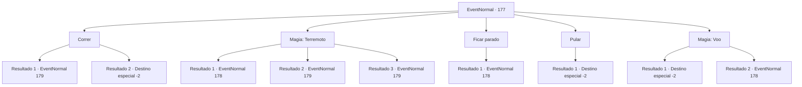

# Eventos normais · 177

[Índice da tabela](index.md) · [Índice geral](../index.md)

ID: `pt:EventNormal:177` · Fonte: `EventNormal4` · Versão: 1.2.47.

Mapeamento estático dos arquivos; a disponibilidade e a execução dependem do estado da run.

## Texto do evento

|drawing_plain| Você se depara com uma manada de gazelas em uma planície tranquila. Elas estão pastando pacificamente na grama seca. De repente, elas começam a fugir freneticamente. Você logo sente o chão tremer sob seus pés. O estrondo se intensifica gradualmente.

## Dados de entrada

```json
{
  "id": 177,
  "grade": 1,
  "place": "",
  "required": "1_2_70"
}
```

## Mapa das escolhas



## Escolhas e resultados

### Escolha 1

Correr

Requisitos e outros campos da escolha:

```json
{
  "required": ""
}
```

#### Resultado 1.1

Você corre o mais rápido que pode, mas o estrondo se aproxima rapidamente. Um verme roxo gigante dispara do chão à sua frente. <link=shake><color=purple>

 "SKREEEEEE!!!"

</color></link> Ele abre sua mandíbula forrada com incontáveis ​​dentes afiados e avança até você.

Continuação registrada: [Evento 179](0179.md) na mesma tabela.

```json
{
  "required": "",
  "chance": "17",
  "nextEvent": 179,
  "type": 1,
  "reward": "6_0_86",
  "place": 0
}
```

#### Resultado 1.2

Você corre o mais rápido que pode, ultrapassando o que quer que esteja causando o estrondo sinistro.

Continuação registrada: [Destino especial `-2`](../destinos-especiais.md).

```json
{
  "required": "",
  "chance": "1|0_6_1",
  "nextEvent": -2,
  "type": 0,
  "reward": "0_2_1"
}
```

### Escolha 2

Magia: Terremoto

Requisitos e outros campos da escolha:

```json
{
  "required": "20_0_3"
}
```

#### Resultado 2.1

Você tenta focar sua mente, mas o estrondo intensificado é muito perturbador. Um verme roxo gigante dispara do chão à sua frente. Ele lentamente abre suas mandíbulas e avança.

Continuação registrada: [Evento 178](0178.md) na mesma tabela.

```json
{
  "required": "",
  "chance": "26",
  "nextEvent": 178,
  "type": 1,
  "reward": ""
}
```

#### Resultado 2.2

Você foca sua mente e lança um feitiço de terremoto. <link=shake>'RUMBLE'</link> O chão se despedaça com um som de abalo, e um verme roxo gigante sai da superfície. Ele se contorce um pouco quando o fluido verde flui para fora de sua superfície. Em seguida, ele abre sua mandíbula forrada com incontáveis ​​dentes afiados e avança até você.

Continuação registrada: [Evento 179](0179.md) na mesma tabela.

```json
{
  "required": "",
  "chance": "1|0_7_1",
  "nextEvent": 179,
  "type": 0,
  "reward": "6_2_86",
  "place": 0
}
```

#### Resultado 2.3

Você foca sua mente e lança um feitiço de terremoto. <link=shake>'RUMBLE'</link> O chão se despedaça com um som de abalo, e um verme roxo gigante sai da superfície. Ele se contorce um pouco quando o fluido verde flui para fora de sua superfície. Em seguida, ele abre sua mandíbula forrada com incontáveis ​​dentes afiados e cobra de você.

Continuação registrada: [Evento 179](0179.md) na mesma tabela.

```json
{
  "required": "",
  "chance": "1|0_12_1",
  "nextEvent": 179,
  "type": 0,
  "reward": "6_2_86",
  "place": 0
}
```

### Escolha 3

Ficar parado

Requisitos e outros campos da escolha:

```json
{
  "required": ""
}
```

#### Resultado 3.1

Você prende a respiração e fica parado. Um verme roxo gigante dispara do chão à sua frente. Ele lentamente abre suas mandíbulas e avança.

Continuação registrada: [Evento 178](0178.md) na mesma tabela.

```json
{
  "required": "",
  "chance": "1",
  "nextEvent": 178,
  "type": 2,
  "reward": ""
}
```

### Escolha 4

Pular

Requisitos e outros campos da escolha:

```json
{
  "required": "20_10_1"
}
```

#### Resultado 4.1

Você salta da superfície. De repente, o estrondo começa a diminuir até desaparecer completamente.

Continuação registrada: [Destino especial `-2`](../destinos-especiais.md).

```json
{
  "required": "",
  "chance": "1",
  "nextEvent": -2,
  "type": 2,
  "reward": "0_2_1"
}
```

### Escolha 5

Magia: Voo

Requisitos e outros campos da escolha:

```json
{
  "required": "20_0_2|1_1_2"
}
```

#### Resultado 5.1

Você lançou um feitiço de vôo. De repente, o estrondo começa a diminuir até desaparecer completamente.

Continuação registrada: [Destino especial `-2`](../destinos-especiais.md).

```json
{
  "required": "",
  "chance": "1|0_14_1",
  "nextEvent": -2,
  "type": 0,
  "reward": "0_2_1|0_1_-1"
}
```

#### Resultado 5.2

Você tenta focar sua mente, mas o estrondo intensificado é muito perturbador. Um verme roxo gigante dispara do chão à sua frente. Ele lentamente abre suas mandíbulas e avança.

Continuação registrada: [Evento 178](0178.md) na mesma tabela.

```json
{
  "required": "",
  "chance": "13",
  "nextEvent": 178,
  "type": 1,
  "reward": "0_1_-1"
}
```

## Referências que chegam a este evento

Nenhum `nextEvent` positivo da mesma tabela aponta para este nó. Isso não prova que seja inacessível: sorteio e estado de história podem selecioná-lo.

