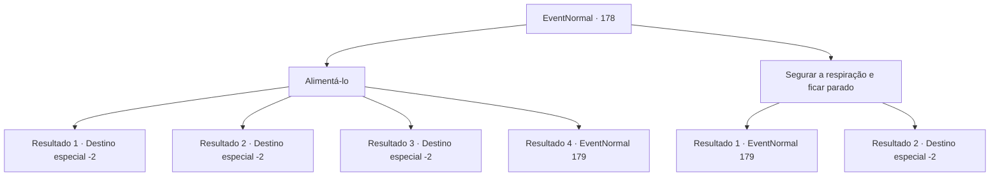

# Eventos normais · 178

[Índice da tabela](index.md) · [Índice geral](../index.md)

ID: `pt:EventNormal:178` · Fonte: `EventNormal4` · Versão: 1.2.47.

Mapeamento estático dos arquivos; a disponibilidade e a execução dependem do estado da run.

## Texto do evento

*Sem texto no arquivo.*

## Dados de entrada

```json
{
  "id": 178,
  "grade": 1,
  "place": "",
  "required": ""
}
```

## Mapa das escolhas



## Escolhas e resultados

### Escolha 1

Alimentá-lo

Requisitos e outros campos da escolha:

```json
{
  "required": "1_7_10"
}
```

#### Resultado 1.1

Você se lembra de que essas minhocas gigantes também se alimentam de minerais. Você pega um minério e o joga na mandíbula da criatura.
 O minério racha enquanto o verme mastiga. Ele mexe um pouco como se para saborear o sabor. Você aproveita a chance e corre.

Continuação registrada: [Destino especial `-2`](../destinos-especiais.md).

```json
{
  "required": "8_126_1",
  "chance": "1",
  "nextEvent": -2,
  "type": 2,
  "reward": "4_126_1|0_2_1"
}
```

#### Resultado 1.2

Você se lembra de que essas minhocas gigantes também se alimentam de minerais. Você pega um minério e o joga na mandíbula da criatura.
 O minério racha enquanto o verme mastiga. Ele mexe um pouco como se para saborear o sabor. Você aproveita a chance e corre.

Continuação registrada: [Destino especial `-2`](../destinos-especiais.md).

```json
{
  "required": "8_128_1",
  "chance": "1",
  "nextEvent": -2,
  "type": 2,
  "reward": "4_128_1|0_2_1"
}
```

#### Resultado 1.3

Você se lembra de que essas minhocas gigantes também se alimentam de minerais. Você pega um minério e o joga na mandíbula da criatura.
 O minério racha enquanto o verme mastiga. Ele mexe um pouco como se para saborear o sabor. Você aproveita a chance e corre.

Continuação registrada: [Destino especial `-2`](../destinos-especiais.md).

```json
{
  "required": "8_129_1",
  "chance": "1",
  "nextEvent": -2,
  "type": 2,
  "reward": "4_129_1|0_2_1"
}
```

#### Resultado 1.4

Você se lembra de que essas minhocas gigantes também se alimentam de minerais. Mas não há nada em você que você possa oferecer. <link=shake><color=purple>

 "SKREEEEEE!!!"

</color></link> Ele abre sua mandíbula forrada com incontáveis ​​dentes afiados e avança até você.

Continuação registrada: [Evento 179](0179.md) na mesma tabela.

```json
{
  "required": "10_126_1|10_128_1|10_129_1",
  "chance": "1",
  "nextEvent": 179,
  "type": 2,
  "reward": "6_0_86",
  "place": 0
}
```

### Escolha 2

Segurar a respiração e ficar parado

Requisitos e outros campos da escolha:

```json
{
  "required": ""
}
```

#### Resultado 2.1

Os dentes afiados do verme gigante escovam a apenas alguns centímetros do seu nariz. Você perde a coragem e dá um passo para trás. O verme abre mais a mandíbula e guincha. <link=shake><color=purple>

 "SKREEEEEE!!!"

</color></link>

Continuação registrada: [Evento 179](0179.md) na mesma tabela.

```json
{
  "required": "",
  "chance": "12",
  "nextEvent": 179,
  "type": 1,
  "reward": "6_0_86",
  "place": 0
}
```

#### Resultado 2.2

Os dentes afiados do verme gigante escovam a apenas alguns centímetros do seu nariz. Você mantém a compostura, pare de respirar completamente e não se mova. O verme não consegue te encontrar e rasteja de volta para o chão.

Continuação registrada: [Destino especial `-2`](../destinos-especiais.md).

```json
{
  "required": "",
  "chance": "1|0_14_1",
  "nextEvent": -2,
  "type": 0,
  "reward": "0_2_1"
}
```

## Referências que chegam a este evento

- [Evento 177 · escolha 2 · resultado 1](0177.md#escolha-2)
- [Evento 177 · escolha 3 · resultado 1](0177.md#escolha-3)
- [Evento 177 · escolha 5 · resultado 2](0177.md#escolha-5)
