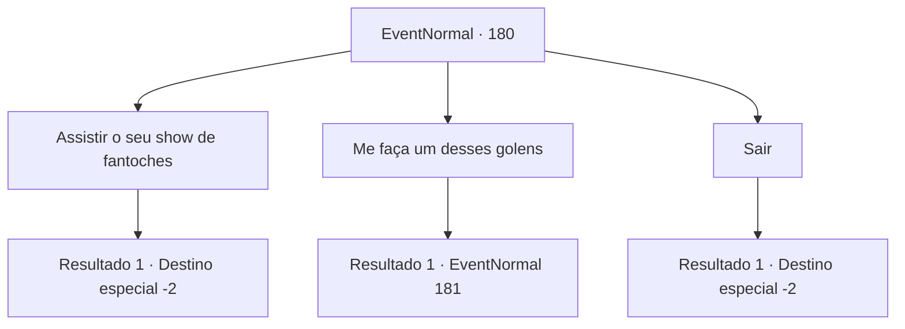

# Eventos normais · 180

[Índice da tabela](index.md) · [Índice geral](../index.md)

ID: `pt:EventNormal:180` · Fonte: `EventNormal4` · Versão: 1.2.47.

Mapeamento estático dos arquivos; a disponibilidade e a execução dependem do estado da run.

## Texto do evento

Você se depara com um anão que está exibindo seus mini golens para as crianças. Ele tem muitos feitos de madeira, cobre, aço e outros materiais. Todos eles se movem por conta própria. Mas o que é mais incrível é o olho direito do anão. É feito de peças mecânicas complexas. Ele olha diretamente para você com seu olho mecânico e fala. 

 "Bem vindo. Quer dar uma olhada?"

 

## Dados de entrada

```json
{
  "id": 180,
  "grade": 1,
  "place": "",
  "required": "5_119_0"
}
```

## Mapa das escolhas



## Escolhas e resultados

### Escolha 1

Assistir o seu show de fantoches

Requisitos e outros campos da escolha:

```json
{
  "required": "1_4_5"
}
```

#### Resultado 1.1

Você se senta para assistir ao pequeno show de marionetes do anão. É um pouco brega, pois é direcionado para crianças, mas divertido mesmo assim. Você paga o anão por seu desempenho e segue em frente.

Continuação registrada: [Destino especial `-2`](../destinos-especiais.md).

```json
{
  "required": "",
  "chance": "1",
  "nextEvent": -2,
  "type": 2,
  "reward": "0_4_-5|0_1_1|0_2_1"
}
```

### Escolha 2

Me faça um desses golens

Requisitos e outros campos da escolha:

```json
{
  "required": ""
}
```

#### Resultado 2.1

Você pede ao anão de olhos mecânicos para construir um pequeno golem para você. Ele olha para você de cima a baixo antes de responder. 

 "Esses pequenos golens se movem de acordo com suas ordens. Se você quiser um, eu preciso dos materiais certos."

 Ele concorda em construir um pequeno golem para você se você conseguir os materiais certos. 

 "Primeiro de tudo... Você tem materiais para o corpo? Qualquer metal serve, mas vou precisar de muito."


Continuação registrada: [Evento 181](0181.md) na mesma tabela.

```json
{
  "required": "",
  "chance": "1",
  "nextEvent": 181,
  "type": 2,
  "reward": ""
}
```

### Escolha 3

Sair

Requisitos e outros campos da escolha:

```json
{
  "required": ""
}
```

#### Resultado 3.1

Você ignora o anão de olhos mecânicos e continua. Ele se volta para as crianças e retoma seu pequeno show de marionetes de golem.

Continuação registrada: [Destino especial `-2`](../destinos-especiais.md).

```json
{
  "required": "",
  "chance": "1",
  "nextEvent": -2,
  "type": 2,
  "reward": ""
}
```

## Referências que chegam a este evento

Nenhum `nextEvent` positivo da mesma tabela aponta para este nó. Isso não prova que seja inacessível: sorteio e estado de história podem selecioná-lo.

