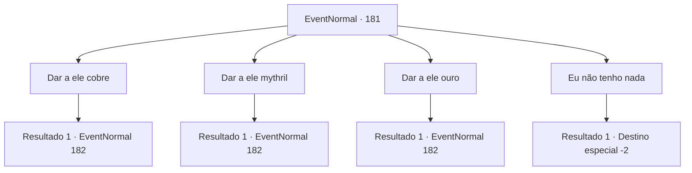

# Eventos normais · 181

[Índice da tabela](index.md) · [Índice geral](../index.md)

ID: `pt:EventNormal:181` · Fonte: `EventNormal4` · Versão: 1.2.47.

Mapeamento estático dos arquivos; a disponibilidade e a execução dependem do estado da run.

## Texto do evento

*Sem texto no arquivo.*

## Dados de entrada

```json
{
  "id": 181,
  "grade": 1,
  "place": "",
  "required": ""
}
```

## Mapa das escolhas



## Escolhas e resultados

### Escolha 1

Dar a ele cobre

Requisitos e outros campos da escolha:

```json
{
  "required": "8_126_3"
}
```

#### Resultado 1.1

Você entrega ao anão alguns pedaços de cobre. Ele pega seu próprio golem minúsculo e diz às crianças para irem para casa. 

 "Aqui, siga-me. Eu não posso fazer isso aqui na rua."

 Você segue o anão até sua oficina. É subterrâneo, com uma pequena porta de aço que parece ter cerca de um metro de espessura. O anão se curva com seu olho mecânico e a porta desliza silenciosamente na parede. 

 "Então há o suficiente para fazer um corpo... Mas preciso de materiais para fazer um coração. O que voce conseguiu?"


Continuação registrada: [Evento 182](0182.md) na mesma tabela.

```json
{
  "required": "",
  "chance": "1",
  "nextEvent": 182,
  "type": 2,
  "reward": "4_126_3|5_119_1|0_2_1"
}
```

### Escolha 2

Dar a ele mythril

Requisitos e outros campos da escolha:

```json
{
  "required": "8_129_1"
}
```

#### Resultado 2.1

Você entrega ao anão seu minério de mythril. Ele pega seu próprio golem minúsculo e diz às crianças para irem para casa. 

 "Ah, mythril... Um bom material. Aqui, siga-me. Eu não posso fazer isso aqui na rua."

 Você segue o anão até sua oficina. É subterrâneo, com uma pequena porta de aço que parece ter cerca de um metro de espessura. O anão se curva com seu olho mecânico e a porta desliza silenciosamente na parede. 

 "Então há o suficiente para fazer um corpo... Mas preciso de materiais para fazer um coração. O que voce conseguiu?"


Continuação registrada: [Evento 182](0182.md) na mesma tabela.

```json
{
  "required": "",
  "chance": "1",
  "nextEvent": 182,
  "type": 2,
  "reward": "4_129_1|5_119_2|0_2_1"
}
```

### Escolha 3

Dar a ele ouro

Requisitos e outros campos da escolha:

```json
{
  "required": "1_4_250"
}
```

#### Resultado 3.1

Você entrega ao anão um pouco de ouro. Ele pega seu próprio golem minúsculo e diz às crianças para irem para casa. 

 "O ouro serve, mas... Hmm. Pode não sair do jeito que você espera. Aqui, siga-me. Eu não posso fazer isso aqui na rua."

 Você segue o anão até sua oficina. É subterrâneo, com uma pequena porta de aço que parece ter cerca de um metro de espessura. O anão se curva com seu olho mecânico e a porta desliza silenciosamente na parede. 

 "Então há o suficiente para fazer um corpo... Mas preciso de materiais para fazer um coração. O que voce conseguiu?"


Continuação registrada: [Evento 182](0182.md) na mesma tabela.

```json
{
  "required": "",
  "chance": "1",
  "nextEvent": 182,
  "type": 2,
  "reward": "0_4_-150|5_119_3|0_2_1"
}
```

### Escolha 4

Eu não tenho nada

Requisitos e outros campos da escolha:

```json
{
  "required": ""
}
```

#### Resultado 4.1

Você diz a ele que não tem nenhum material. O anão cruza os braços e responde. 

 "Hmm... Desculpe, não posso fazer nada por você sem materiais."

 Ele se volta para as crianças e retoma seu pequeno show de marionetes. Você os deixa para trás e vai embora.

Continuação registrada: [Destino especial `-2`](../destinos-especiais.md).

```json
{
  "required": "",
  "chance": "1",
  "nextEvent": -2,
  "type": 2,
  "reward": ""
}
```

## Referências que chegam a este evento

- [Evento 180 · escolha 2 · resultado 1](0180.md#escolha-2)
