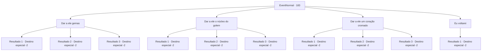

# Eventos normais · 183

[Índice da tabela](index.md) · [Índice geral](../index.md)

ID: `pt:EventNormal:183` · Fonte: `EventNormal4` · Versão: 1.2.47.

Mapeamento estático dos arquivos; a disponibilidade e a execução dependem do estado da run.

## Texto do evento

Você se depara com o anão que faz mini golens. Ele coça a cabeça e cumprimenta você. 

 "Pensando bem, eu nunca me apresentei. Sou Iman. Eu sei quem você é, ouvi histórias sobre você. Então... trouxe os materiais certos para um coração?"


## Dados de entrada

```json
{
  "id": 183,
  "grade": 2,
  "place": "",
  "required": "5_120_2|1_2_50"
}
```

## Mapa das escolhas



## Escolhas e resultados

### Escolha 1

Dar a ele gemas

Requisitos e outros campos da escolha:

```json
{
  "required": "17_0_2"
}
```

#### Resultado 1.1

Você entrega ao anão algumas gemas. Ele os inspeciona cuidadosamente com seu olho mecânico. 

 "Espere aqui. Não toque em nada... Talvez vá sentar naquela cama."

 O anão coloca a planta de cobre e um golem na mesa e começa a trabalhar. 

 Algumas horas depois, ele lhe entrega um pequeno golem feito de cobre. 

 "Ai está. Pegue. Não há necessidade de me pagar. Eu faço isso por diversão, não para viver."

 Você pega o pequeno golem e sai da oficina do anão.

Continuação registrada: [Destino especial `-2`](../destinos-especiais.md).

```json
{
  "required": "5_119_1",
  "chance": "1",
  "nextEvent": -2,
  "type": 2,
  "reward": "3_10154_1|5_119_9|0_2_1|5_120_9"
}
```

#### Resultado 1.2

Você entrega ao anão algumas gemas. Ele os inspeciona cuidadosamente com seu olho mecânico. 

 "Espere aqui. Não toque em nada... Talvez vá sentar naquela cama."

 O anão coloca o mythril e uma planta de golem na mesa e começa a trabalhar. 

 Algumas horas depois, ele entrega a você um pequeno golem feito de mythril. 

 "Ai está. Pegue. Não há necessidade de me pagar. Eu faço isso por diversão, não para viver."

 Você pega o pequeno golem e sai da oficina do anão.

Continuação registrada: [Destino especial `-2`](../destinos-especiais.md).

```json
{
  "required": "5_119_2",
  "chance": "1",
  "nextEvent": -2,
  "type": 2,
  "reward": "3_10155_1|5_119_9|0_2_1|5_120_9"
}
```

#### Resultado 1.3

Você entrega ao anão algumas gemas. Ele os inspeciona cuidadosamente com seu olho mecânico. 

 "Espere aqui. Não toque em nada... Talvez vá sentar naquela cama."

 O anão coloca o ouro e uma planta de golem na mesa e começa a trabalhar. 

 Algumas horas depois, ele lhe entrega um pequeno golem feito de ouro. 

 "Ai está. Pegue. Não há necessidade de me pagar. Eu faço isso por diversão, não para viver."

 Você pega o pequeno golem e sai da oficina do anão.

Continuação registrada: [Destino especial `-2`](../destinos-especiais.md).

```json
{
  "required": "5_119_3",
  "chance": "1",
  "nextEvent": -2,
  "type": 2,
  "reward": "3_10156_1|5_119_9|0_2_1|5_120_9"
}
```

### Escolha 2

Dar a ele o núcleo do golem

Requisitos e outros campos da escolha:

```json
{
  "required": "8_101_1"
}
```

#### Resultado 2.1

Você entrega ao anão o núcleo de um golem. Ele a inspeciona cuidadosamente com seu olho mecânico. 

 "Espere aqui. Não toque em nada... Talvez vá sentar naquela cama."

 O anão coloca a planta de cobre e um golem na mesa e começa a trabalhar. 

 Algumas horas depois, ele lhe entrega um pequeno golem feito de cobre. 

 "Ai está. Pegue. Não há necessidade de me pagar. Eu faço isso por diversão, não para viver."

 Você pega o pequeno golem e sai da oficina do anão.

Continuação registrada: [Destino especial `-2`](../destinos-especiais.md).

```json
{
  "required": "5_119_1",
  "chance": "1",
  "nextEvent": -2,
  "type": 2,
  "reward": "4_101_1|3_10154_1|5_119_9|0_2_1|5_120_9"
}
```

#### Resultado 2.2

Você entrega ao anão o núcleo de um golem. Ele a inspeciona cuidadosamente com seu olho mecânico. 

 "Espere aqui. Não toque em nada... Talvez vá sentar naquela cama."

 O anão coloca o mythril e uma planta de golem na mesa e começa a trabalhar. 

 Algumas horas depois, ele entrega a você um pequeno golem feito de mythril. 

 "Ai está. Pegue. Não há necessidade de me pagar. Eu faço isso por diversão, não para viver."

 Você pega o pequeno golem e sai da oficina do anão.

Continuação registrada: [Destino especial `-2`](../destinos-especiais.md).

```json
{
  "required": "5_119_2",
  "chance": "1",
  "nextEvent": -2,
  "type": 2,
  "reward": "4_101_1|3_10155_1|5_119_9|0_2_1|5_120_9"
}
```

#### Resultado 2.3

Você entrega o núcleo de um golem ao anão.. Ele a inspeciona cuidadosamente com seu olho mecânico. 

 "Espere aqui. Não toque em nada... Talvez vá sentar naquela cama."

 O anão coloca o ouro e uma planta de golem na mesa e começa a trabalhar. 

 Algumas horas depois, ele lhe entrega um pequeno golem feito de ouro. 

 "Ai está. Pegue. Não há necessidade de me pagar. Eu faço isso por diversão, não para viver."

 Você pega o pequeno golem e sai da oficina do anão.

Continuação registrada: [Destino especial `-2`](../destinos-especiais.md).

```json
{
  "required": "5_119_3",
  "chance": "1",
  "nextEvent": -2,
  "type": 2,
  "reward": "4_101_1|3_10156_1|5_119_9|0_2_1|5_120_9"
}
```

### Escolha 3

Dar a ele um coração cromado

Requisitos e outros campos da escolha:

```json
{
  "required": "8_110_1"
}
```

#### Resultado 3.1

Você entrega ao anão um coração cromado. Ele parece um pouco confuso enquanto pega o pingente. 

 "Hmm... não posso garantir que valerá a pena derreter este, mas vou ver o que posso fazer."

 O anão coloca a planta de cobre e um golem na mesa e começa a trabalhar. 

 Algumas horas depois, ele lhe entrega um pequeno golem feito de cobre. 

 "Ai está. Pegue. Não há necessidade de me pagar. Eu faço isso por diversão, não para viver."

 Você pega o pequeno golem e sai da oficina do anão.

Continuação registrada: [Destino especial `-2`](../destinos-especiais.md).

```json
{
  "required": "5_119_1",
  "chance": "1",
  "nextEvent": -2,
  "type": 2,
  "reward": "4_110_1|3_10154_1|5_119_9|0_2_1|5_120_9"
}
```

#### Resultado 3.2

Você entrega ao anão um coração cromado. Ele parece um pouco confuso enquanto pega o pingente. 

 "Espere aqui. Não toque em nada... Talvez vá sentar naquela cama."

 O anão coloca o mythril e uma planta de golem na mesa e começa a trabalhar. 

 Algumas horas depois, ele entrega a você um pequeno golem feito de mythril. 

 "Ai está. Pegue. Não há necessidade de me pagar. Eu faço isso por diversão, não para viver."

 Você pega o pequeno golem e sai da oficina do anão.

Continuação registrada: [Destino especial `-2`](../destinos-especiais.md).

```json
{
  "required": "5_119_2",
  "chance": "1",
  "nextEvent": -2,
  "type": 2,
  "reward": "4_110_1|3_10155_1|5_119_9|0_2_1|5_120_9"
}
```

#### Resultado 3.3

Você entrega ao anão um coração cromado. Ele parece um pouco confuso enquanto pega o pingente. 

 "Espere aqui. Não toque em nada... Talvez vá sentar naquela cama."

 O anão coloca o ouro e uma planta de golem na mesa e começa a trabalhar. 

 Algumas horas depois, ele lhe entrega um pequeno golem feito de ouro. 

 "Ai está. Pegue. Não há necessidade de me pagar. Eu faço isso por diversão, não para viver."

 Você pega o pequeno golem e sai da oficina do anão.

Continuação registrada: [Destino especial `-2`](../destinos-especiais.md).

```json
{
  "required": "5_119_3",
  "chance": "1",
  "nextEvent": -2,
  "type": 2,
  "reward": "4_110_1|3_10156_1|5_119_9|0_2_1|5_120_9"
}
```

### Escolha 4

Eu voltarei

Requisitos e outros campos da escolha:

```json
{
  "required": ""
}
```

#### Resultado 4.1

Você não tem nada para usar como núcleo, então promete que voltará com os materiais certos. O anão de olhos mecânicos acena adeus, dizendo para você voltar a qualquer momento.

Continuação registrada: [Destino especial `-2`](../destinos-especiais.md).

```json
{
  "required": "",
  "chance": "1",
  "nextEvent": -2,
  "type": 2,
  "reward": "5_120_2"
}
```

## Referências que chegam a este evento

Nenhum `nextEvent` positivo da mesma tabela aponta para este nó. Isso não prova que seja inacessível: sorteio e estado de história podem selecioná-lo.

