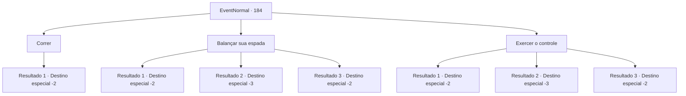

# Eventos normais · 184

[Índice da tabela](index.md) · [Índice geral](../index.md)

ID: `pt:EventNormal:184` · Fonte: `EventNormal4` · Versão: 1.2.47.

Mapeamento estático dos arquivos; a disponibilidade e a execução dependem do estado da run.

## Texto do evento

<link=shake> 

 "GRAAAARGH EEEEAAAAH !!!"

</link> Você está cruzando um campo quando ouve gritos agonizantes. Você olha para cima e vê alguns fazendeiros correndo em sua direção. Eles estão balançando os braços no ar, e você percebe que eles estão sendo perseguidos por abelhas.

## Dados de entrada

```json
{
  "id": 184,
  "grade": 1,
  "place": "",
  "required": ""
}
```

## Mapa das escolhas



## Escolhas e resultados

### Escolha 1

Correr

Requisitos e outros campos da escolha:

```json
{
  "required": ""
}
```

#### Resultado 1.1

Você escapa antes que os fazendeiros e as abelhas se aproximem. Os gritos diminuem até se tornarem inaudíveis.

Continuação registrada: [Destino especial `-2`](../destinos-especiais.md).

```json
{
  "required": "",
  "chance": "1",
  "nextEvent": -2,
  "type": 2,
  "reward": ""
}
```

### Escolha 2

Balançar sua espada

Requisitos e outros campos da escolha:

```json
{
  "required": ""
}
```

#### Resultado 2.1

Você balança sua arma no enxame de abelhas, dando tempo para os fazendeiros escaparem. Algumas abelhas caem mortas, mas outras conseguem se aproximar e picar você. As picadas são demais para serem expostas e você começa a recuar enquanto balança sua arma. Você mal consegue se livrar deles depois de uma longa corrida e inúmeras picadas. 

 "Nós... nós poderíamos ter morrido lá fora, obrigado. Mas você está bem...?"

 O veneno se espalha pelo seu sangue a cada respiração áspera que você dá, e logo o mundo fica escuro. 

 Você acorda em uma cama surrada, sem saber quanto tempo se passou. Um dos fazendeiros que você salvou entra assim que você abre os olhos. 

 "Ah, você está acordado. Trouxemos você aqui depois que desmaiou. Obrigado novamente por nos salvar. Devemos nossas vidas a você."

 Ele lhe entrega um pouco de ouro e batatas como sinal de gratidão.

Continuação registrada: [Destino especial `-2`](../destinos-especiais.md).

```json
{
  "required": "1_0_2",
  "chance": "10",
  "nextEvent": -2,
  "type": 1,
  "reward": "0_4_10|3_137_1|0_3_2|0_0_-1|0_2_1"
}
```

#### Resultado 2.2

Você balança sua arma no enxame de abelhas, dando tempo para os fazendeiros escaparem. Algumas abelhas caem mortas, mas outras conseguem se aproximar e picar você. As picadas são demais para suportar, e você começa a recuar enquanto balança sua arma. Você mal consegue se livrar deles depois de uma longa corrida e inúmeras picadas. 

 "Nós... nós poderíamos ter morrido lá fora, obrigado. Mas você está bem...?"

 O veneno se espalha pelo seu sangue a cada respiração áspera que você dá, e logo o mundo fica escuro.

Continuação registrada: [Destino especial `-3`](../destinos-especiais.md).

```json
{
  "required": "2_0_2",
  "chance": "10",
  "nextEvent": -3,
  "type": 1,
  "reward": "0_0_-1"
}
```

#### Resultado 2.3

Você balança sua arma no enxame de abelhas, dando tempo para os fazendeiros escaparem. Então você prossegue para eliminar todas as abelhas da existência. Os fazendeiros param de correr e se maravilham com suas habilidades. 

 "Isso foi incrível!"

 "Nós poderíamos ter morrido lá fora, obrigado."

 Eles lhe entregam ouro e batatas como sinal de gratidão.

Continuação registrada: [Destino especial `-2`](../destinos-especiais.md).

```json
{
  "required": "",
  "chance": "1|0_6_1",
  "nextEvent": -2,
  "type": 0,
  "reward": "0_4_10|3_137_1|0_3_2|0_2_1"
}
```

### Escolha 3

Exercer o controle

Requisitos e outros campos da escolha:

```json
{
  "required": ""
}
```

#### Resultado 3.1

Você tenta exercer controle sobre o enxame de abelhas. Mas eles permanecem inalterados quando começam a picar você. As picadas são demais para suportar, e você começa a recuar enquanto balança sua arma. Você mal consegue se livrar deles depois de uma longa corrida e inúmeras picadas. 

 "Nós... nós poderíamos ter morrido lá fora, obrigado. Mas você está bem...?"

 O veneno se espalha pelo seu sangue a cada respiração áspera que você dá, e logo o mundo fica escuro. 

 Você acorda em uma cama surrada, sem saber quanto tempo se passou. Um dos fazendeiros que você salvou entra assim que você abre os olhos. 

 "Ah, você está acordado. Trouxemos você aqui depois que desmaiou. Obrigado novamente por nos salvar. Devemos nossas vidas a você."

 Ele lhe entrega um pouco de ouro e batatas como sinal de gratidão.

Continuação registrada: [Destino especial `-2`](../destinos-especiais.md).

```json
{
  "required": "1_0_2",
  "chance": "10",
  "nextEvent": -2,
  "type": 1,
  "reward": "0_4_10|3_137_1|0_3_2|0_0_-1|0_2_1"
}
```

#### Resultado 3.2

Você tenta exercer controle sobre o enxame de abelhas. Mas eles permanecem inalterados quando começam a picar você. As picadas são demais para suportar, e você começa recuando enquanto você balança sua arma. Você mal consegue se livrar deles depois de uma longa corrida e inúmeras picadas. 

 "Nós... nós poderíamos ter morrido lá fora, obrigado. Mas você está bem...?"

 O veneno se espalha pelo seu sangue a cada respiração áspera que você dá, e logo o mundo fica escuro.

Continuação registrada: [Destino especial `-3`](../destinos-especiais.md).

```json
{
  "required": "2_0_2",
  "chance": "10",
  "nextEvent": -3,
  "type": 1,
  "reward": "0_0_-1"
}
```

#### Resultado 3.3

Você exerce controle sobre o enxame de abelhas. Eles param de atacar os fazendeiros, cercam você por um momento e depois voam. Os fazendeiros olham para você incrédulos. 

 "Mas como...?"

 "Nós poderíamos ter morrido lá fora, obrigado."

 Eles lhe entregam ouro e batatas como sinal de gratidão.

Continuação registrada: [Destino especial `-2`](../destinos-especiais.md).

```json
{
  "required": "",
  "chance": "1|0_12_1",
  "nextEvent": -2,
  "type": 0,
  "reward": "0_4_10|3_137_1|0_3_2|0_2_1"
}
```

## Referências que chegam a este evento

Nenhum `nextEvent` positivo da mesma tabela aponta para este nó. Isso não prova que seja inacessível: sorteio e estado de história podem selecioná-lo.

