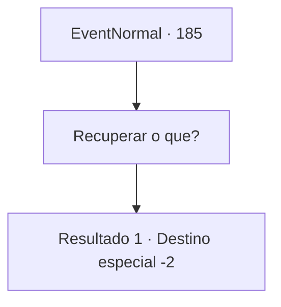

# Eventos normais · 185

[Índice da tabela](index.md) · [Índice geral](../index.md)

ID: `pt:EventNormal:185` · Fonte: `EventNormal4` · Versão: 1.2.47.

Mapeamento estático dos arquivos; a disponibilidade e a execução dependem do estado da run.

## Texto do evento

No meio da noite, você encontra um velho padre no lugar onde a realidade acaba e os sonhos começam. Ele está vestido de forma diferente dos padres de qualquer outra religião, coberto quase inteiramente por um longo pedaço de pano branco, exceto pelo rosto e ombro direito. 

 "Venha para o Templo de Huiti... É hora de recuperá-lo..."


## Dados de entrada

```json
{
  "id": 185,
  "grade": 2,
  "place": "",
  "required": "8_107_1|5_106_0"
}
```

## Mapa das escolhas



## Escolhas e resultados

### Escolha 1

Recuperar o que?

Requisitos e outros campos da escolha:

```json
{
  "required": ""
}
```

#### Resultado 1.1

Você pergunta o que eles estão tentando recuperar, e ele levanta um dedo ossudo para apontar para sua armadura dourada. 

 "Essa armadura... vou explicar quando você chegar aqui."

 Então ele desaparece no ar. Você sente que deveria ver esse estranho encontro e decidir ir para o Templo de Huiti.

Continuação registrada: [Destino especial `-2`](../destinos-especiais.md).

```json
{
  "required": "",
  "chance": "1",
  "nextEvent": -2,
  "type": 2,
  "reward": "5_106_1"
}
```

## Referências que chegam a este evento

Nenhum `nextEvent` positivo da mesma tabela aponta para este nó. Isso não prova que seja inacessível: sorteio e estado de história podem selecioná-lo.

