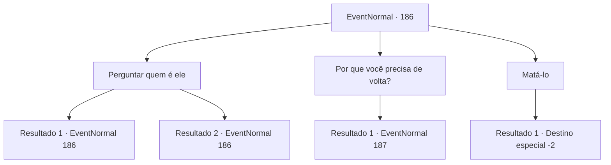

# Eventos normais · 186

[Índice da tabela](index.md) · [Índice geral](../index.md)

ID: `pt:EventNormal:186` · Fonte: `EventNormal4` · Versão: 1.2.47.

Mapeamento estático dos arquivos; a disponibilidade e a execução dependem do estado da run.

## Texto do evento

|drawing_oldTemple| Você chega às antigas ruínas do Templo de Huiti. As vinhas tomaram conta da estrutura de pedra, pois o legado do deus foi esquecido com o tempo. As portas do templo se abrem como se estivessem esperando por você. Lá dentro está o velho padre que você viu em seus sonhos. 

 "Você veio. Saudações..."


## Dados de entrada

```json
{
  "id": 186,
  "grade": 2,
  "place": "",
  "required": "8_107_1|5_106_1"
}
```

## Mapa das escolhas



## Escolhas e resultados

### Escolha 1

Perguntar quem é ele

Requisitos e outros campos da escolha:

```json
{
  "required": "5_106_1"
}
```

#### Resultado 1.1

Você pergunta quem é o padre. Ele olha fixamente para sua armadura de ouro enquanto responde. 

 "Como você pode ver, sou um humilde servo do grande Huiti. Um deus há muito esquecido... mas um dos melhores quando se trata de truques e táticas. Mas essa especialidade acabou se tornando uma tragédia. O conquistador Sandros veio aqui para rezar antes de sua grande campanha. Foi ele que emprestou sua armadura dourada que foi usada por esta estátua. Precisamos dele de volta."

 Você se lembra de uma lição de história distante. O Sandros do qual o padre está falando é uma figura de dez séculos atrás.

Continuação registrada: [Evento 186](0186.md) na mesma tabela.

```json
{
  "required": "1_7_12",
  "chance": "1",
  "nextEvent": 186,
  "type": 2,
  "reward": "5_106_2"
}
```

#### Resultado 1.2

Você pergunta quem é o padre. Ele olha fixamente para sua armadura de ouro enquanto responde. 

 "Como você pode ver, sou um humilde servo do grande Huiti. Um deus há muito esquecido... mas um dos melhores quando se trata de truques e táticas. Mas essa especialidade acabou se tornando uma tragédia. O conquistador Sandros veio aqui para rezar antes de sua grande campanha. Foi ele que emprestou sua armadura dourada que foi usada por esta estátua. Precisamos dele de volta."


Continuação registrada: [Evento 186](0186.md) na mesma tabela.

```json
{
  "required": "",
  "chance": "1",
  "nextEvent": 186,
  "type": 2,
  "reward": "5_106_2"
}
```

### Escolha 2

Por que você precisa de volta?

Requisitos e outros campos da escolha:

```json
{
  "required": ""
}
```

#### Resultado 2.1

Você pergunta por que deveria devolver a armadura. O padre balança a cabeça lentamente enquanto continua. 

 "Sim Sim. Eu entendo sua confusão. Mas, por favor, considere... Eu esperei muito tempo por isso. Prometo compensá-lo bem pela armadura."


Continuação registrada: [Evento 187](0187.md) na mesma tabela.

```json
{
  "required": "",
  "chance": "1",
  "nextEvent": 187,
  "type": 2,
  "reward": ""
}
```

### Escolha 3

Matá-lo

Requisitos e outros campos da escolha:

```json
{
  "required": ""
}
```

#### Resultado 3.1

Você saca sua arma e a aponta para o padre. Ele desaparece no ar, enquanto sua voz ecoa por todo o templo. 

 "Já esperei o suficiente..."

 Você vai para fora, sentindo-se um pouco perturbado.

Continuação registrada: [Destino especial `-2`](../destinos-especiais.md).

```json
{
  "required": "",
  "chance": "1",
  "nextEvent": -2,
  "type": 2,
  "reward": "5_106_3"
}
```

## Referências que chegam a este evento

- [Evento 186 · escolha 1 · resultado 1](0186.md#escolha-1)
- [Evento 186 · escolha 1 · resultado 2](0186.md#escolha-1)
