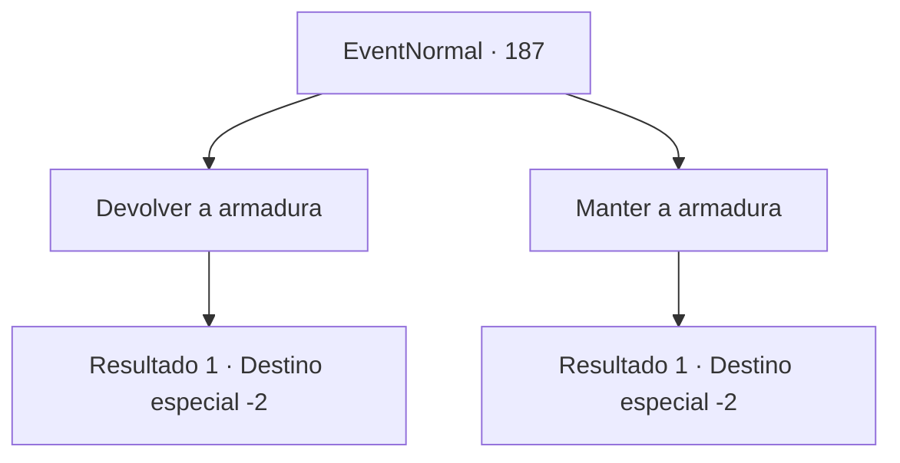

# Eventos normais · 187

[Índice da tabela](index.md) · [Índice geral](../index.md)

ID: `pt:EventNormal:187` · Fonte: `EventNormal4` · Versão: 1.2.47.

Mapeamento estático dos arquivos; a disponibilidade e a execução dependem do estado da run.

## Texto do evento

*Sem texto no arquivo.*

## Dados de entrada

```json
{
  "id": 187,
  "grade": 1,
  "place": "",
  "required": ""
}
```

## Mapa das escolhas



## Escolhas e resultados

### Escolha 1

Devolver a armadura

Requisitos e outros campos da escolha:

```json
{
  "required": ""
}
```

#### Resultado 1.1

Você devolve a armadura dourada ao padre. Ele o pendura sobre a empoeirada estátua huiti. Então ele solta um suspiro de alívio. 

 "Sou eternamente grato pelo seu gesto gentil. Você será recompensado de acordo."

 O padre desaparece no ar, e as telhas abaixo de seus pés se movem para revelar uma escada que leva para baixo. Abaixo você encontra o porão do templo, que contém uma quantidade incrivelmente grande de ouro. Você pega o ouro e vai para fora.

Continuação registrada: [Destino especial `-2`](../destinos-especiais.md).

```json
{
  "required": "",
  "chance": "1",
  "nextEvent": -2,
  "type": 2,
  "reward": "0_4_600|5_106_4|4_107_1|0_2_1"
}
```

### Escolha 2

Manter a armadura

Requisitos e outros campos da escolha:

```json
{
  "required": ""
}
```

#### Resultado 2.1

Você se recusa a devolver a armadura. O padre desaparece no ar, enquanto sua voz ecoa por todo o templo. 

 "Já esperei o suficiente..."

 Você vai para fora, sentindo-se um pouco perturbado.

Continuação registrada: [Destino especial `-2`](../destinos-especiais.md).

```json
{
  "required": "",
  "chance": "1",
  "nextEvent": -2,
  "type": 2,
  "reward": "5_106_3"
}
```

## Referências que chegam a este evento

- [Evento 186 · escolha 2 · resultado 1](0186.md#escolha-2)
