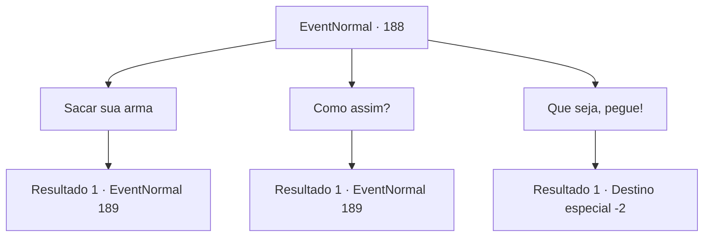

# Eventos normais · 188

[Índice da tabela](index.md) · [Índice geral](../index.md)

ID: `pt:EventNormal:188` · Fonte: `EventNormal4` · Versão: 1.2.47.

Mapeamento estático dos arquivos; a disponibilidade e a execução dependem do estado da run.

## Texto do evento

Você cai em um sono leve e encontra uma nuvem de névoa com muitos olhos brilhantes. A névoa se solidifica em um exército de espectros. 

 "Devolva o que foi roubado de nós."

 Os gritos deles se chocam contra você como uma centena de ondas.

## Dados de entrada

```json
{
  "id": 188,
  "grade": 2,
  "place": "",
  "required": "5_106_3|8_107_1"
}
```

## Mapa das escolhas



## Escolhas e resultados

### Escolha 1

Sacar sua arma

Requisitos e outros campos da escolha:

```json
{
  "required": ""
}
```

#### Resultado 1.1

Você saca sua arma e enfrenta o exército de espectros.

Continuação registrada: [Evento 189](0189.md) na mesma tabela.

```json
{
  "required": "",
  "chance": "1",
  "nextEvent": 189,
  "type": 2,
  "reward": "6_0_78",
  "place": 6
}
```

### Escolha 2

Como assim?

Requisitos e outros campos da escolha:

```json
{
  "required": ""
}
```

#### Resultado 2.1

Você pergunta o que exatamente eles querem, mas eles não estão aqui para responder às suas perguntas. Eles simplesmente avançam até você com seus gritos de guerra estridentes.

Continuação registrada: [Evento 189](0189.md) na mesma tabela.

```json
{
  "required": "",
  "chance": "1",
  "nextEvent": 189,
  "type": 2,
  "reward": "6_0_78",
  "place": 6
}
```

### Escolha 3

Que seja, pegue!

Requisitos e outros campos da escolha:

```json
{
  "required": ""
}
```

#### Resultado 3.1

Você grita para eles pegarem o que quiserem. O exército se transforma em uma rajada de vento que sopra direto em você. Quando você acorda com uma sensação horrivelmente perturbadora, sua armadura está longe de ser vista.

Continuação registrada: [Destino especial `-2`](../destinos-especiais.md).

```json
{
  "required": "",
  "chance": "1",
  "nextEvent": -2,
  "type": 2,
  "reward": "4_107_1|5_106_9|0_2_1"
}
```

## Referências que chegam a este evento

Nenhum `nextEvent` positivo da mesma tabela aponta para este nó. Isso não prova que seja inacessível: sorteio e estado de história podem selecioná-lo.

