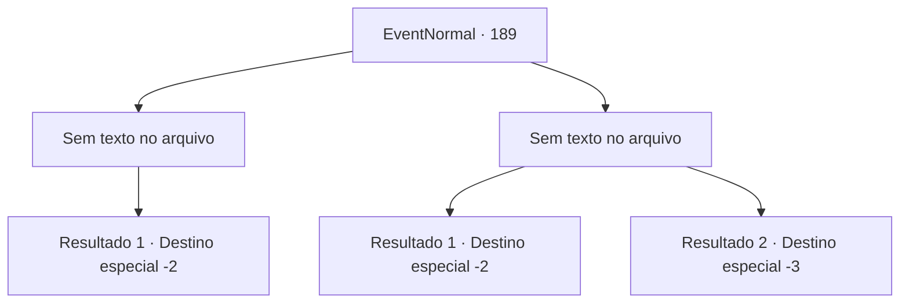

# Eventos normais · 189

[Índice da tabela](index.md) · [Índice geral](../index.md)

ID: `pt:EventNormal:189` · Fonte: `EventNormal4` · Versão: 1.2.47.

Mapeamento estático dos arquivos; a disponibilidade e a execução dependem do estado da run.

## Texto do evento

*Sem texto no arquivo.*

## Dados de entrada

```json
{
  "id": 189,
  "grade": 1,
  "place": "",
  "required": ""
}
```

## Mapa das escolhas



## Escolhas e resultados

### Escolha 1

*Sem texto no arquivo; o papel dessa opção depende da interface do jogo.*

Requisitos e outros campos da escolha:

```json
{
  "required": ""
}
```

#### Resultado 1.1

Você derrota o exército fantasma. Mas a voz do padre ecoa à distância. 

 "Este não é o fim..."

 Quando você abre os olhos, o exército fantasma e o sacerdote não estão em lugar algum para serem vistos ou ouvidos. Mas você tem certeza que eles vão voltar. Você esfrega o rosto e se levanta.

Continuação registrada: [Destino especial `-2`](../destinos-especiais.md).

```json
{
  "required": "",
  "chance": "1",
  "nextEvent": -2,
  "type": 2,
  "reward": ""
}
```

### Escolha 2

*Sem texto no arquivo; o papel dessa opção depende da interface do jogo.*

Requisitos e outros campos da escolha:

```json
{
  "required": ""
}
```

#### Resultado 2.1

Você acorda no momento em que a lança de um fantasma mergulha em seu corpo. Sua cabeça dói como se tivesse sido atingida por um porrete, e seu coração bate como se você estivesse correndo o tempo todo. Você sente seu corpo com as mãos e descobre que a armadura ainda está lá. Você descansa enquanto tenta se acalmar.

Continuação registrada: [Destino especial `-2`](../destinos-especiais.md).

```json
{
  "required": "1_1_2",
  "chance": "1",
  "nextEvent": -2,
  "type": 2,
  "reward": "0_1_-1|0_2_1"
}
```

#### Resultado 2.2

Sua mente desaparece no abismo enquanto a lança de um espectro mergulha em seu corpo.

Continuação registrada: [Destino especial `-3`](../destinos-especiais.md).

```json
{
  "required": "2_1_2",
  "chance": "1",
  "nextEvent": -3,
  "type": 2,
  "reward": "0_1_-1"
}
```

## Referências que chegam a este evento

- [Evento 188 · escolha 1 · resultado 1](0188.md#escolha-1)
- [Evento 188 · escolha 2 · resultado 1](0188.md#escolha-2)
