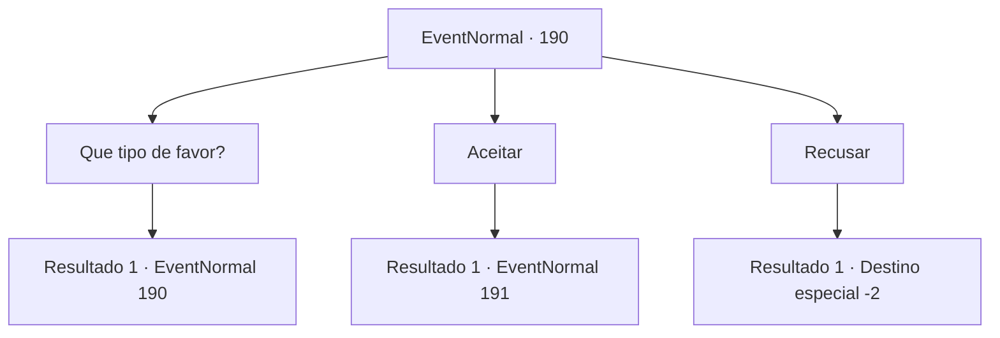

# Eventos normais · 190

[Índice da tabela](index.md) · [Índice geral](../index.md)

ID: `pt:EventNormal:190` · Fonte: `EventNormal4` · Versão: 1.2.47.

Mapeamento estático dos arquivos; a disponibilidade e a execução dependem do estado da run.

## Texto do evento

Alguém chama você na rua. |drawing_kiki| Ela parece uma mercadora viajante com sua mochila gigante e ela se aproxima de você com um sorriso educado que as pessoas exibem quando pedem favores. 

 "Aventureiro, posso lhe pedir um pequeno favor?"


## Dados de entrada

```json
{
  "id": 190,
  "grade": 1,
  "place": "",
  "required": "5_127_0"
}
```

## Mapa das escolhas



## Escolhas e resultados

### Escolha 1

Que tipo de favor?

Requisitos e outros campos da escolha:

```json
{
  "required": "5_127_0"
}
```

#### Resultado 1.1

O comerciante se chama Kiki. Ela está preocupada com sua receita recentemente cada vez menor. Ela cruza os braços enquanto explica. 

 "Então, eu estava pensando que alguns itens raros poderiam ajudar nas minhas vendas... Você poderia me ajudar?"


Continuação registrada: [Evento 190](0190.md) na mesma tabela.

```json
{
  "required": "",
  "chance": "1",
  "nextEvent": 190,
  "type": 2,
  "reward": "5_127_1"
}
```

### Escolha 2

Aceitar

Requisitos e outros campos da escolha:

```json
{
  "required": "5_127_1"
}
```

#### Resultado 2.1

Você decide ajudar Kiki. 

 "Diga-me quando você conseguir itens raros! Ou... você pode me apresentar a alguém que possa ajudar!"


Continuação registrada: [Evento 191](0191.md) na mesma tabela.

```json
{
  "required": "",
  "chance": "1",
  "nextEvent": 191,
  "type": 2,
  "reward": ""
}
```

### Escolha 3

Recusar

Requisitos e outros campos da escolha:

```json
{
  "required": "5_127_1"
}
```

#### Resultado 3.1

Você se recusa a ajudar Kiki. Ela segue em frente, parecendo um pouco desapontada.

Continuação registrada: [Destino especial `-2`](../destinos-especiais.md).

```json
{
  "required": "",
  "chance": "1",
  "nextEvent": -2,
  "type": 2,
  "reward": "5_127_9"
}
```

## Referências que chegam a este evento

- [Evento 190 · escolha 1 · resultado 1](0190.md#escolha-1)
