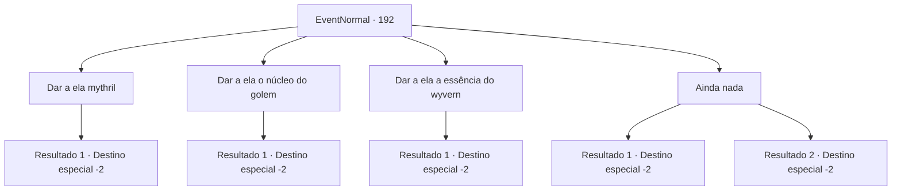

# Eventos normais · 192

[Índice da tabela](index.md) · [Índice geral](../index.md)

ID: `pt:EventNormal:192` · Fonte: `EventNormal4` · Versão: 1.2.47.

Mapeamento estático dos arquivos; a disponibilidade e a execução dependem do estado da run.

## Texto do evento

Você encontra a mercadora Kiki novamente. Ela acena para você debaixo de sua enorme mochila. 

 "Aventureiro! Nos encontramos novamente. Se importa se eu te perguntar como... foi?"


## Dados de entrada

```json
{
  "id": 192,
  "grade": 1,
  "place": "",
  "required": "5_127_3"
}
```

## Mapa das escolhas



## Escolhas e resultados

### Escolha 1

Dar a ela mythril

Requisitos e outros campos da escolha:

```json
{
  "required": "8_129_1"
}
```

#### Resultado 1.1

Você entrega o minério de mythril para ela. O rosto de Kiki se ilumina enquanto ela inspeciona o metal. 

 "Mithril...! Muito obrigado! Um momento por favor..."

 Ela abre a mochila e tira uma bolsa de ouro. Ela entrega a você enquanto fala. 

 "É um pouco mais do que outros fornecedores pagariam a você, hehe."

 Ela acena adeus e vai embora.

Continuação registrada: [Destino especial `-2`](../destinos-especiais.md).

```json
{
  "required": "",
  "chance": "1",
  "nextEvent": -2,
  "type": 2,
  "reward": "0_4_100|4_129_1|5_127_9|0_2_1"
}
```

### Escolha 2

Dar a ela o núcleo do golem

Requisitos e outros campos da escolha:

```json
{
  "required": "8_101_1"
}
```

#### Resultado 2.1

Você entrega a ela um núcleo de golem O rosto de Kiki se ilumina enquanto ela inspeciona o item. 

 "Um núcleo de golem...! Eu poderia carregá-lo com mana..."

 Ela abre a mochila e tira uma bolsa de ouro. Ela entrega a você enquanto fala. 

 "É um pouco mais do que outros fornecedores pagariam a você, hehe."

 Ela se despede e vai embora.

Continuação registrada: [Destino especial `-2`](../destinos-especiais.md).

```json
{
  "required": "",
  "chance": "1",
  "nextEvent": -2,
  "type": 2,
  "reward": "4_101_1|0_4_35|5_127_9|0_2_1"
}
```

### Escolha 3

Dar a ela a essência do wyvern

Requisitos e outros campos da escolha:

```json
{
  "required": "8_45_1"
}
```

#### Resultado 3.1

Você entrega a ela a essência de um wyvern O rosto de Kiki se ilumina enquanto ela inspeciona o orbe. 

 "A essência de um wyvern...! Muito obrigado! Um momento por favor..."

 Ela abre a mochila e tira uma bolsa de ouro. Ela entrega a você enquanto fala. 

 "É um pouco mais do que outros fornecedores pagariam a você, hehe."

 Ela acena adeus e vai embora.

Continuação registrada: [Destino especial `-2`](../destinos-especiais.md).

```json
{
  "required": "",
  "chance": "1",
  "nextEvent": -2,
  "type": 2,
  "reward": "4_45_1|0_4_75|5_127_9|0_2_1"
}
```

### Escolha 4

Ainda nada

Requisitos e outros campos da escolha:

```json
{
  "required": ""
}
```

#### Resultado 4.1

Ela dá um tapinha no seu ombro. 

 "Não precisa se apressar, aventureiro! Até outra hora!"

 Kiki sai com um sorriso alegre no rosto.

Continuação registrada: [Destino especial `-2`](../destinos-especiais.md).

```json
{
  "required": "",
  "chance": "1",
  "nextEvent": -2,
  "type": 2,
  "reward": "5_127_3"
}
```

#### Resultado 4.2

Ela dá um tapinha no seu ombro. 

 "Não precisa se apressar, aventureiro! Até outra hora!"

 Kiki sai com um sorriso alegre no rosto.

Continuação registrada: [Destino especial `-2`](../destinos-especiais.md).

```json
{
  "required": "",
  "chance": "1",
  "nextEvent": -2,
  "type": 2,
  "reward": "5_127_9"
}
```

## Referências que chegam a este evento

Nenhum `nextEvent` positivo da mesma tabela aponta para este nó. Isso não prova que seja inacessível: sorteio e estado de história podem selecioná-lo.

