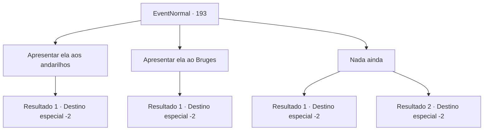

# Eventos normais · 193

[Índice da tabela](index.md) · [Índice geral](../index.md)

ID: `pt:EventNormal:193` · Fonte: `EventNormal4` · Versão: 1.2.47.

Mapeamento estático dos arquivos; a disponibilidade e a execução dependem do estado da run.

## Texto do evento

Você encontra a mercadora Kiki novamente. Ela acena para você debaixo de sua enorme mochila. 

 "Aventureiro! Nos encontramos novamente. Se importa se eu te perguntar como... foi?"

 

## Dados de entrada

```json
{
  "id": 193,
  "grade": 1,
  "place": "",
  "required": "5_127_2"
}
```

## Mapa das escolhas



## Escolhas e resultados

### Escolha 1

Apresentar ela aos andarilhos

Requisitos e outros campos da escolha:

```json
{
  "required": "-1|12_2_5|12_2_6|14_2_4|14_2_3|5_200_1"
}
```

#### Resultado 1.1

Você se lembra dos andarilhos que viajaram pela cova subterrânea com você. Você escreve uma carta de recomendação para Kiki sobre os três. Ela dá um sorriso brilhante e se curva repetidamente em gratidão. 

 "Não é muito, mas por favor, pegue!"

 Ela lhe entrega uma pequena bolsa de ouro. Então ela acena adeus e vai embora.

Continuação registrada: [Destino especial `-2`](../destinos-especiais.md).

```json
{
  "required": "",
  "chance": "1",
  "nextEvent": -2,
  "type": 2,
  "reward": "0_4_50|5_127_4|0_2_1"
}
```

### Escolha 2

Apresentar ela ao Bruges

Requisitos e outros campos da escolha:

```json
{
  "required": "-1|12_4_4|12_4_6|5_199_1"
}
```

#### Resultado 2.1

Você se lembra de Bruges e dos refugiados do norte. Você escreve uma carta de recomendação para Kiki sobre os três. Ela dá um sorriso brilhante e se curva repetidamente em gratidão. 

 "Não é muito, mas por favor, pegue!"

 Ela lhe entrega uma pequena bolsa de ouro. Então ela se despede e vai embora.

Continuação registrada: [Destino especial `-2`](../destinos-especiais.md).

```json
{
  "required": "",
  "chance": "1",
  "nextEvent": -2,
  "type": 2,
  "reward": "0_4_50|5_127_5|0_2_1"
}
```

### Escolha 3

Nada ainda

Requisitos e outros campos da escolha:

```json
{
  "required": ""
}
```

#### Resultado 3.1

Ela dá um tapinha no seu ombro. 

 "Não precisa se apressar, aventureiro! Até outra hora!"

 Kiki sai com um sorriso alegre no rosto.

Continuação registrada: [Destino especial `-2`](../destinos-especiais.md).

```json
{
  "required": "",
  "chance": "1",
  "nextEvent": -2,
  "type": 2,
  "reward": "5_127_2"
}
```

#### Resultado 3.2

Ela dá um tapinha no seu ombro. 

 "Não precisa se apressar, aventureiro! Até outra hora!"

 Kiki sai com um sorriso alegre no rosto.

Continuação registrada: [Destino especial `-2`](../destinos-especiais.md).

```json
{
  "required": "",
  "chance": "2",
  "nextEvent": -2,
  "type": 2,
  "reward": "5_127_9"
}
```

## Referências que chegam a este evento

Nenhum `nextEvent` positivo da mesma tabela aponta para este nó. Isso não prova que seja inacessível: sorteio e estado de história podem selecioná-lo.

