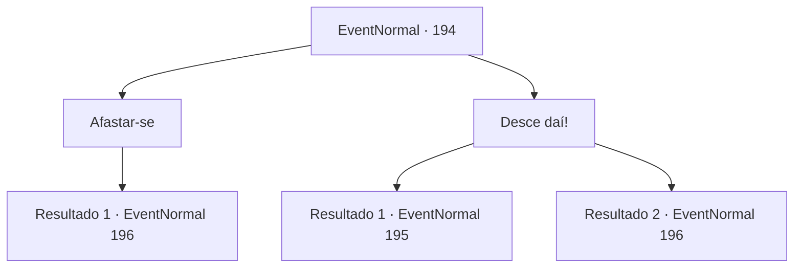

# Eventos normais · 194

[Índice da tabela](index.md) · [Índice geral](../index.md)

ID: `pt:EventNormal:194` · Fonte: `EventNormal4` · Versão: 1.2.47.

Mapeamento estático dos arquivos; a disponibilidade e a execução dependem do estado da run.

## Texto do evento

|drawing_wagons| Você se depara com um grupo de caravanas que viajam em fila indiana na estrada. O motorista bem na frente o vê e franze a testa. 

 "Sai da frente!"

 Ele parece um pouco estranho, e você percebe que ele não é daqui. 

## Dados de entrada

```json
{
  "id": 194,
  "grade": 2,
  "place": "",
  "required": "5_127_4"
}
```

## Mapa das escolhas



## Escolhas e resultados

### Escolha 1

Afastar-se

Requisitos e outros campos da escolha:

```json
{
  "required": "1_3_0"
}
```

#### Resultado 1.1

Você se afasta sem dizer uma palavra. As caravanas levantam nuvens de poeira enquanto continuam, mas de repente param novamente. Uma porta se abre em uma delas e sai uma figura familiar. 

 "Aventureiro!!"

 Kiki o cumprimenta encantadamente apertando sua mão. Ela começa a atualizar você sobre seu progresso após o aperto de mão apaixonado. Ela se tornou amiga de Nisil por sua recomendação e começou a negociar com mercadores do leste. 

 "Tudo graças a você, é claro!"

 Ela quer te agradecer com um de seus itens.

Continuação registrada: [Evento 196](0196.md) na mesma tabela.

```json
{
  "required": "",
  "chance": "1",
  "nextEvent": 196,
  "type": 2,
  "reward": ""
}
```

### Escolha 2

Desce daí!

Requisitos e outros campos da escolha:

```json
{
  "required": ""
}
```

#### Resultado 2.1

Você provoca o motorista a descer e lutar. Ele arregaça as mangas, pula da cadeira e estala o pescoço. 

 "Você começou isso."


Continuação registrada: [Evento 195](0195.md) na mesma tabela.

```json
{
  "required": "",
  "chance": "1",
  "nextEvent": 195,
  "type": 2,
  "reward": "6_0_90",
  "place": 0
}
```

#### Resultado 2.2

Você provoca o motorista a descer e lutar. Ele pula da cadeira e sai correndo. Uma porta se abre em uma das caravanas e sai uma figura familiar. 

 "Aventureiro!!"

 Kiki o cumprimenta encantadamente apertando sua mão. Ela começa a atualizar você sobre seu progresso após o aperto de mão apaixonado. Ela se tornou amiga de Nisil por sua recomendação e começou a negociar com mercadores do leste. 

 "Tudo graças a você, é claro!"

 Ela quer te agradecer com um de seus itens.

Continuação registrada: [Evento 196](0196.md) na mesma tabela.

```json
{
  "required": "",
  "chance": "1",
  "nextEvent": 196,
  "type": 2,
  "reward": ""
}
```

## Referências que chegam a este evento

Nenhum `nextEvent` positivo da mesma tabela aponta para este nó. Isso não prova que seja inacessível: sorteio e estado de história podem selecioná-lo.

