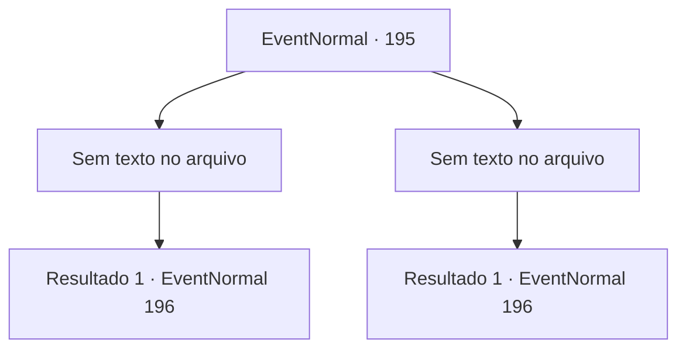

# Eventos normais · 195

[Índice da tabela](index.md) · [Índice geral](../index.md)

ID: `pt:EventNormal:195` · Fonte: `EventNormal4` · Versão: 1.2.47.

Mapeamento estático dos arquivos; a disponibilidade e a execução dependem do estado da run.

## Texto do evento

*Sem texto no arquivo.*

## Dados de entrada

```json
{
  "id": 195,
  "grade": 1,
  "place": "",
  "required": ""
}
```

## Mapa das escolhas



## Escolhas e resultados

### Escolha 1

*Sem texto no arquivo; o papel dessa opção depende da interface do jogo.*

Requisitos e outros campos da escolha:

```json
{
  "required": ""
}
```

#### Resultado 1.1

Você bateu no motorista rude sem sentido. De repente, uma porta se abre em uma das caravanas e sai uma figura familiar. 

 "Aventureiro!!"

 Kiki o cumprimenta alegremente e pede desculpas pelo comportamento do motorista. 

 "Gostaria que nosso reencontro pudesse ter sido mais agradável, pena..."

 Ela começa a atualizar você sobre seu progresso após o aperto de mão apaixonado. Ela se tornou amiga de Nisil por sua recomendação e começou a negociar com mercadores do leste. 

 "Tudo graças a você, é claro!"

 Ela quer te agradecer com um de seus itens.

Continuação registrada: [Evento 196](0196.md) na mesma tabela.

```json
{
  "required": "",
  "chance": "1",
  "nextEvent": 196,
  "type": 2,
  "reward": "0_3_-1"
}
```

### Escolha 2

*Sem texto no arquivo; o papel dessa opção depende da interface do jogo.*

Requisitos e outros campos da escolha:

```json
{
  "required": ""
}
```

#### Resultado 2.1

O motorista bate em você sem motivo nenhum. Ele fica nervoso e grita algo em uma língua estranha, mas você pode dizer que ele está xingando. Uma porta se abre em uma delas e sai uma figura familiar. 

 "Aventureiro!!"

 Kiki o cumprimenta alegremente e pede desculpas pelo comportamento do motorista. 

 "Gostaria que nosso reencontro pudesse ter sido mais agradável, uma pena..."

 Ela começa a atualizar você sobre seu progresso após o aperto de mão apaixonado. Ela se tornou amiga de Nisil por sua recomendação e começou a negociar com mercadores do leste. 

 "Tudo graças a você, é claro!"

 Ela quer te agradecer com um de seus itens.

Continuação registrada: [Evento 196](0196.md) na mesma tabela.

```json
{
  "required": "",
  "chance": "1",
  "nextEvent": 196,
  "type": 2,
  "reward": ""
}
```

## Referências que chegam a este evento

- [Evento 194 · escolha 2 · resultado 1](0194.md#escolha-2)
