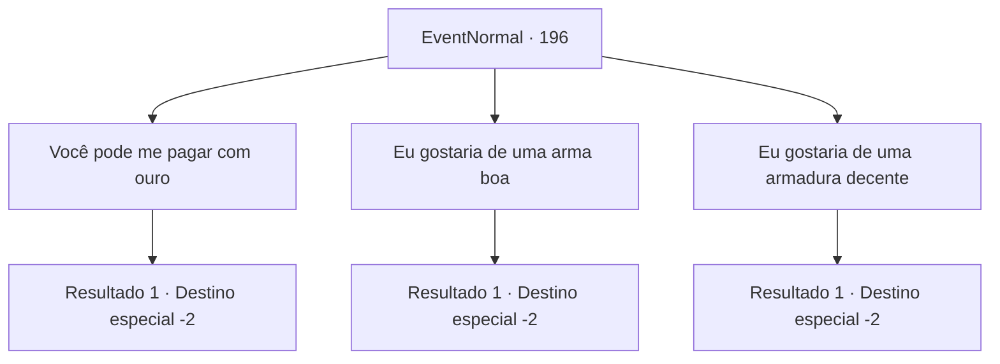

# Eventos normais · 196

[Índice da tabela](index.md) · [Índice geral](../index.md)

ID: `pt:EventNormal:196` · Fonte: `EventNormal4` · Versão: 1.2.47.

Mapeamento estático dos arquivos; a disponibilidade e a execução dependem do estado da run.

## Texto do evento

*Sem texto no arquivo.*

## Dados de entrada

```json
{
  "id": 196,
  "grade": 1,
  "place": "",
  "required": ""
}
```

## Mapa das escolhas



## Escolhas e resultados

### Escolha 1

Você pode me pagar com ouro

Requisitos e outros campos da escolha:

```json
{
  "required": ""
}
```

#### Resultado 1.1

Você pede a ela o pagamento em ouro. Ela gesticula para um dos mercadores trazer uma bolsa pesada de ouro e entrega para você. 

 "Foi ótimo vê-lo novamente! Tanto tempo!"

 Kiki volta para a caravana e parte para o deserto empoeirado.

Continuação registrada: [Destino especial `-2`](../destinos-especiais.md).

```json
{
  "required": "",
  "chance": "1",
  "nextEvent": -2,
  "type": 2,
  "reward": "0_2_1|0_4_200|5_127_9"
}
```

### Escolha 2

Eu gostaria de uma arma boa

Requisitos e outros campos da escolha:

```json
{
  "required": ""
}
```

#### Resultado 2.1

Você pede a ela uma boa arma. Ela gesticula para um dos mercadores trazer uma espada coberta de seda e a entrega a você. 

 "Foi ótimo te ver novamente! Tanto tempo!"

 Kiki volta para a caravana e parte para o deserto empoeirado.

Continuação registrada: [Destino especial `-2`](../destinos-especiais.md).

```json
{
  "required": "",
  "chance": "1",
  "nextEvent": -2,
  "type": 2,
  "reward": "0_2_1|3_176_1|3_180_1|5_127_9"
}
```

### Escolha 3

Eu gostaria de uma armadura decente

Requisitos e outros campos da escolha:

```json
{
  "required": ""
}
```

#### Resultado 3.1

Você pergunta a ela se ela tem alguma armadura decente. Ela gesticula para um dos comerciantes trazer um caixote de madeira e entrega para você. Você o abre e encontra roupas de algodão bem dobradas. 

 "Foi ótimo te ver novamente! Tanto tempo!"

 Kiki volta para a caravana e parte para o deserto empoeirado.

Continuação registrada: [Destino especial `-2`](../destinos-especiais.md).

```json
{
  "required": "",
  "chance": "1",
  "nextEvent": -2,
  "type": 2,
  "reward": "0_2_1|3_189_1|5_127_9"
}
```

## Referências que chegam a este evento

- [Evento 194 · escolha 1 · resultado 1](0194.md#escolha-1)
- [Evento 194 · escolha 2 · resultado 2](0194.md#escolha-2)
- [Evento 195 · escolha 1 · resultado 1](0195.md#escolha-1)
- [Evento 195 · escolha 2 · resultado 1](0195.md#escolha-2)
