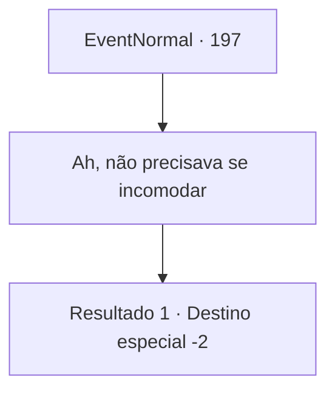

# Eventos normais · 197

[Índice da tabela](index.md) · [Índice geral](../index.md)

ID: `pt:EventNormal:197` · Fonte: `EventNormal4` · Versão: 1.2.47.

Mapeamento estático dos arquivos; a disponibilidade e a execução dependem do estado da run.

## Texto do evento

Você montou acampamento para relaxar um pouco. De repente, a mercadora Kiki aparece do nada. Ela o cumprimenta com um sorriso ainda mais brilhante do que antes. 

 "Aventureiro! Já faz tempo!"

 Ela lhe conta que Bruges e os refugiados estão ajudando muito com os suprimentos e, consequentemente, as vendas. Ela quer retribuir a sua ajuda de uma forma ou de outra.

## Dados de entrada

```json
{
  "id": 197,
  "grade": 2,
  "place": "",
  "required": "5_127_5"
}
```

## Mapa das escolhas



## Escolhas e resultados

### Escolha 1

Ah, não precisava se incomodar

Requisitos e outros campos da escolha:

```json
{
  "required": ""
}
```

#### Resultado 1.1

Kiki enfia a mão na mochila e tira uma bolsa de ouro. Então ela cava mais fundo e tira algumas poções. Ela entrega o dinheiro e os itens. 

 "Foi ótimo te ver novamente! Tanto tempo!"

 Kiki volta para a caravana e parte para o deserto empoeirado.

Continuação registrada: [Destino especial `-2`](../destinos-especiais.md).

```json
{
  "required": "",
  "chance": "1",
  "nextEvent": -2,
  "type": 2,
  "reward": "0_2_1|0_4_100|5_127_9|3_36_1|3_37_1"
}
```

## Referências que chegam a este evento

Nenhum `nextEvent` positivo da mesma tabela aponta para este nó. Isso não prova que seja inacessível: sorteio e estado de história podem selecioná-lo.

