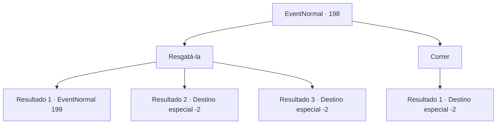

# Eventos normais · 198

[Índice da tabela](index.md) · [Índice geral](../index.md)

ID: `pt:EventNormal:198` · Fonte: `EventNormal4` · Versão: 1.2.47.

Mapeamento estático dos arquivos; a disponibilidade e a execução dependem do estado da run.

## Texto do evento

<link=shake>

 "SOCORRO!! POR FAVOR, ALGUÉM ME AJUDA!!!"

</link> Você ouve uma mulher gritando à distância. Você corre e encontra uma carruagem quebrada e uma mulher de joelhos cercada por bandidos armados.

## Dados de entrada

```json
{
  "id": 198,
  "grade": 1,
  "place": "",
  "required": "5_125_0"
}
```

## Mapa das escolhas



## Escolhas e resultados

### Escolha 1

Resgatá-la

Requisitos e outros campos da escolha:

```json
{
  "required": ""
}
```

#### Resultado 1.1

Você decide resgatar a mulher. Os ladrões sacam seus punhais e porretes. 

 "Você deveria ter cuidado da sua vida."


Continuação registrada: [Evento 199](0199.md) na mesma tabela.

```json
{
  "required": "2_2_50",
  "chance": "1",
  "nextEvent": 199,
  "type": 2,
  "reward": "6_3_2",
  "place": 0
}
```

#### Resultado 1.2

Você decide resgatar a mulher. Os ladrões reconhecem instantaneamente seu rosto e fogem. A mulher agradece, e promete retribuir antes que ela vá embora.

Continuação registrada: [Destino especial `-2`](../destinos-especiais.md).

```json
{
  "required": "1_2_50",
  "chance": "1",
  "nextEvent": -2,
  "type": 2,
  "reward": "0_3_1|5_125_1|0_2_1"
}
```

#### Resultado 1.3

Você pega a Respondente, perguntando se a mulher realmente está em perigo. A Respondente voa para a garganta da mulher em um piscar de olhos. 

 "Eu... eu não estou. É tudo uma fraude..."

 Depois que ela responde, a Respondente retorna para você. Você vê os olhares de surpresa nos rostos dos bandidos. Eles gritam para a mulher, perguntando o que diabos ela está fazendo. Você rapidamente se despede, com os bandidos e a mulher discutindo.

Continuação registrada: [Destino especial `-2`](../destinos-especiais.md).

```json
{
  "required": "8_93_1",
  "chance": "1",
  "nextEvent": -2,
  "type": 2,
  "reward": "5_125_9|0_2_1"
}
```

### Escolha 2

Correr

Requisitos e outros campos da escolha:

```json
{
  "required": ""
}
```

#### Resultado 2.1

Você lentamente se afasta do bando de ladrões gritantes. E segue seu caminho para longe.

Continuação registrada: [Destino especial `-2`](../destinos-especiais.md).

```json
{
  "required": "",
  "chance": "1",
  "nextEvent": -2,
  "type": 2,
  "reward": ""
}
```

## Referências que chegam a este evento

Nenhum `nextEvent` positivo da mesma tabela aponta para este nó. Isso não prova que seja inacessível: sorteio e estado de história podem selecioná-lo.

