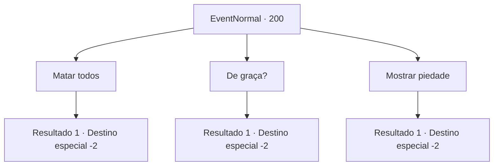

# Eventos normais · 200

[Índice da tabela](index.md) · [Índice geral](../index.md)

ID: `pt:EventNormal:200` · Fonte: `EventNormal4` · Versão: 1.2.47.

Mapeamento estático dos arquivos; a disponibilidade e a execução dependem do estado da run.

## Texto do evento

*Sem texto no arquivo.*

## Dados de entrada

```json
{
  "id": 200,
  "grade": 1,
  "place": "",
  "required": ""
}
```

## Mapa das escolhas



## Escolhas e resultados

### Escolha 1

Matar todos

Requisitos e outros campos da escolha:

```json
{
  "required": ""
}
```

#### Resultado 1.1

Você mata todos os ladrões junto com a mulher. Você vasculha seus pertences e pega seu ouro.

Continuação registrada: [Destino especial `-2`](../destinos-especiais.md).

```json
{
  "required": "",
  "chance": "1",
  "nextEvent": -2,
  "type": 2,
  "reward": "5_125_9|0_4_100|0_3_-5"
}
```

### Escolha 2

De graça?

Requisitos e outros campos da escolha:

```json
{
  "required": ""
}
```

#### Resultado 2.1

Você diz a ela que o perdão tem um custo. Com as mãos tremendo, a mulher lhe entrega seu ouro. Então ela ajuda os ladrões e sai correndo.

Continuação registrada: [Destino especial `-2`](../destinos-especiais.md).

```json
{
  "required": "",
  "chance": "1",
  "nextEvent": -2,
  "type": 2,
  "reward": "0_3_-1|0_4_100|5_125_9"
}
```

### Escolha 3

Mostrar piedade

Requisitos e outros campos da escolha:

```json
{
  "required": ""
}
```

#### Resultado 3.1

Você decide perdoar os ladrões. A mulher agradece várias vezes antes de fugir com os ladrões.

Continuação registrada: [Destino especial `-2`](../destinos-especiais.md).

```json
{
  "required": "",
  "chance": "1",
  "nextEvent": -2,
  "type": 2,
  "reward": "0_3_3|5_125_9"
}
```

## Referências que chegam a este evento

- [Evento 199 · escolha 1 · resultado 2](0199.md#escolha-1)
- [Evento 199 · escolha 1 · resultado 3](0199.md#escolha-1)
- [Evento 202 · escolha 1 · resultado 1](0202.md#escolha-1)
