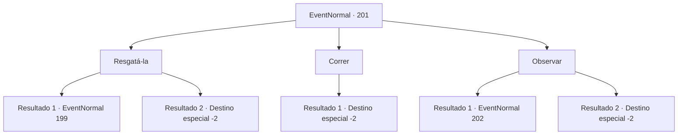

# Eventos normais · 201

[Índice da tabela](index.md) · [Índice geral](../index.md)

ID: `pt:EventNormal:201` · Fonte: `EventNormal4` · Versão: 1.2.47.

Mapeamento estático dos arquivos; a disponibilidade e a execução dependem do estado da run.

## Texto do evento

<link=shake>

 "SOCORRO!! ALGUEM ME AJUDA!!!"

</link> Você ouve um grito familiar vindo da mesma mulher. Você corre para encontrar uma carruagem quebrada e uma mulher de joelhos cercada por bandidos armados. Igual da última vez.

## Dados de entrada

```json
{
  "id": 201,
  "grade": 1,
  "place": "",
  "required": "5_125_1"
}
```

## Mapa das escolhas



## Escolhas e resultados

### Escolha 1

Resgatá-la

Requisitos e outros campos da escolha:

```json
{
  "required": ""
}
```

#### Resultado 1.1

Você decide resgatar a mulher mais uma vez. Os ladrões sacam seus punhais e porretes. 

 "Você deveria ter cuidado da sua vida."


Continuação registrada: [Evento 199](0199.md) na mesma tabela.

```json
{
  "required": "2_2_50",
  "chance": "1",
  "nextEvent": 199,
  "type": 2,
  "reward": "6_3_2",
  "place": 0
}
```

#### Resultado 1.2

Você decide resgatar a mulher mais uma vez. Os ladrões reconhecem instantaneamente seu rosto e fogem. A mulher agradece, e promete retribuir antes que ela vá embora.

Continuação registrada: [Destino especial `-2`](../destinos-especiais.md).

```json
{
  "required": "1_2_50",
  "chance": "1",
  "nextEvent": -2,
  "type": 2,
  "reward": "0_3_1|5_125_2"
}
```

### Escolha 2

Correr

Requisitos e outros campos da escolha:

```json
{
  "required": ""
}
```

#### Resultado 2.1

Você lentamente se afasta do bando de ladrões gritantes. E então você segue seu caminho para longe.

Continuação registrada: [Destino especial `-2`](../destinos-especiais.md).

```json
{
  "required": "",
  "chance": "1",
  "nextEvent": -2,
  "type": 2,
  "reward": ""
}
```

### Escolha 3

Observar

Requisitos e outros campos da escolha:

```json
{
  "required": "1_7_11"
}
```

#### Resultado 3.1

Você tem a sensação de que a mulher e os ladrões são uma equipe. Você cruza os braços e os observa por um tempo, e os ladrões armados começar a conversar entre si. Então eles levantam suas armas e se aproximam de você. 

 "Pirralho desgraçado, descobrindo tão rápido..."


Continuação registrada: [Evento 202](0202.md) na mesma tabela.

```json
{
  "required": "2_2_50",
  "chance": "1",
  "nextEvent": 202,
  "type": 2,
  "reward": "6_3_2",
  "place": 0
}
```

#### Resultado 3.2

Você tem a sensação de que a mulher e os ladrões são uma equipe. Você cruza os braços e os observa por um tempo, e os ladrões armados começar a conversar entre si. Então eles fogem com a mulher.

Continuação registrada: [Destino especial `-2`](../destinos-especiais.md).

```json
{
  "required": "1_2_50",
  "chance": "1",
  "nextEvent": -2,
  "type": 2,
  "reward": "5_125_9|0_2_1"
}
```

## Referências que chegam a este evento

Nenhum `nextEvent` positivo da mesma tabela aponta para este nó. Isso não prova que seja inacessível: sorteio e estado de história podem selecioná-lo.

