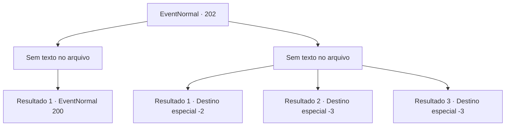

# Eventos normais · 202

[Índice da tabela](index.md) · [Índice geral](../index.md)

ID: `pt:EventNormal:202` · Fonte: `EventNormal4` · Versão: 1.2.47.

Mapeamento estático dos arquivos; a disponibilidade e a execução dependem do estado da run.

## Texto do evento

*Sem texto no arquivo.*

## Dados de entrada

```json
{
  "id": 202,
  "grade": 1,
  "place": "",
  "required": ""
}
```

## Mapa das escolhas



## Escolhas e resultados

### Escolha 1

*Sem texto no arquivo; o papel dessa opção depende da interface do jogo.*

Requisitos e outros campos da escolha:

```json
{
  "required": ""
}
```

#### Resultado 1.1

Você bateu nos bandidos. De repente, a mulher tenta esfaqueá-lo com um punhal. Mas seus movimentos são tão desajeitados que você evita o ataque com facilidade. 

 "Eu... uh..."

 A mulher entra em pânico. Ela larga a adaga e se afasta. Então ela começa a implorar por misericórdia. 

 "Eu sinto muito! Por favor me perdoe!"


Continuação registrada: [Evento 200](0200.md) na mesma tabela.

```json
{
  "required": "",
  "chance": "1",
  "nextEvent": 200,
  "type": 2,
  "reward": ""
}
```

### Escolha 2

*Sem texto no arquivo; o papel dessa opção depende da interface do jogo.*

Requisitos e outros campos da escolha:

```json
{
  "required": ""
}
```

#### Resultado 2.1

Os ladrões bateram em você. A mulher vasculha sua mochila e pega seu ouro. 

 "Hehehe! Muito obrigada!"

 Então ela foge com os ladrões.

Continuação registrada: [Destino especial `-2`](../destinos-especiais.md).

```json
{
  "required": "1_1_2|1_0_2",
  "chance": "1",
  "nextEvent": -2,
  "type": 2,
  "reward": "0_4_100|0_0_-1|0_1_-1|5_125_9|0_2_1"
}
```

#### Resultado 2.2

Um dos ladrões bate em você com um porrete na cabeça.

Continuação registrada: [Destino especial `-3`](../destinos-especiais.md).

```json
{
  "required": "2_0_2",
  "chance": "1",
  "nextEvent": -3,
  "type": 2,
  "reward": "0_0_-1|0_1_-1"
}
```

#### Resultado 2.3

Um dos ladrões bate em você com um porrete na cabeça.

Continuação registrada: [Destino especial `-3`](../destinos-especiais.md).

```json
{
  "required": "2_1_2",
  "chance": "1",
  "nextEvent": -3,
  "type": 2,
  "reward": "0_0_-1|0_1_-1"
}
```

## Referências que chegam a este evento

- [Evento 201 · escolha 3 · resultado 1](0201.md#escolha-3)
