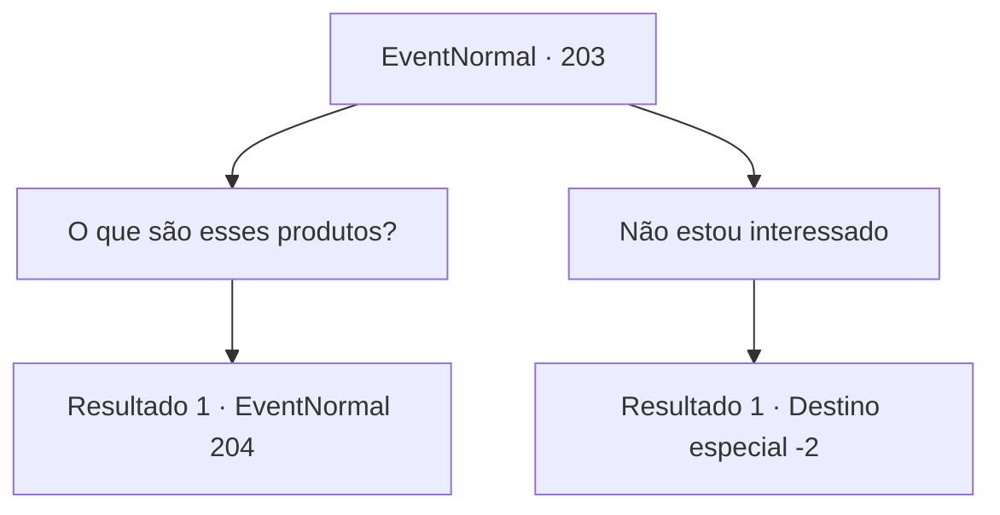

# Eventos normais · 203

[Índice da tabela](index.md) · [Índice geral](../index.md)

ID: `pt:EventNormal:203` · Fonte: `EventNormal4` · Versão: 1.2.47.

Mapeamento estático dos arquivos; a disponibilidade e a execução dependem do estado da run.

## Texto do evento

Ao passar pela vila, você encontra um estande com faixas coloridas. Você pode ver algumas corujas ao redor do estande e nele diz o seguinte. 

 "Seu Ativo, Invista Agora! Um mundo onde o ouro ganha ouro!"

 Pessoas vestidas com roupas elegantes estão se apresentando. Talvez seja um negócio em que recebam investimentos para os negócios que mantêm, e quando o lucro é criado, você o recebe de volta.

## Dados de entrada

```json
{
  "id": 203,
  "grade": 1,
  "place": "",
  "required": "1_2_35|5_128_0|5_129_0|5_130_0"
}
```

## Mapa das escolhas



## Escolhas e resultados

### Escolha 1

O que são esses produtos?

Requisitos e outros campos da escolha:

```json
{
  "required": ""
}
```

#### Resultado 1.1

Você pede a um homem bem vestido uma explicação sobre os produtos. Ele desdobra um catálogo contendo diversos produtos, dizendo para você escolher um que goste.

Continuação registrada: [Evento 204](0204.md) na mesma tabela.

```json
{
  "required": "",
  "chance": "1",
  "nextEvent": 204,
  "type": 2,
  "reward": ""
}
```

### Escolha 2

Não estou interessado

Requisitos e outros campos da escolha:

```json
{
  "required": ""
}
```

#### Resultado 2.1

Você se vira e se afasta do palco.

Continuação registrada: [Destino especial `-2`](../destinos-especiais.md).

```json
{
  "required": "",
  "chance": "1",
  "nextEvent": -2,
  "type": 2,
  "reward": "5_128_9"
}
```

## Referências que chegam a este evento

- [Evento 205 · escolha 3 · resultado 1](0205.md#escolha-3)
- [Evento 206 · escolha 3 · resultado 1](0206.md#escolha-3)
- [Evento 207 · escolha 3 · resultado 1](0207.md#escolha-3)
