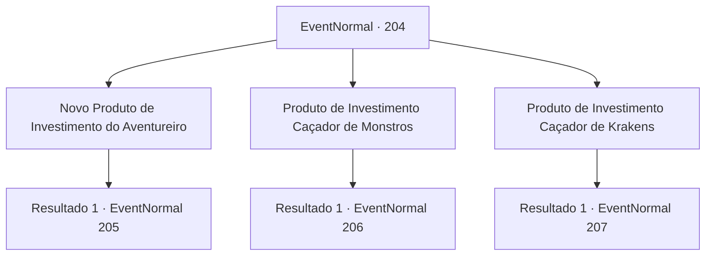

# Eventos normais · 204

[Índice da tabela](index.md) · [Índice geral](../index.md)

ID: `pt:EventNormal:204` · Fonte: `EventNormal4` · Versão: 1.2.47.

Mapeamento estático dos arquivos; a disponibilidade e a execução dependem do estado da run.

## Texto do evento

*Sem texto no arquivo.*

## Dados de entrada

```json
{
  "id": 204,
  "grade": 1,
  "place": "",
  "required": ""
}
```

## Mapa das escolhas



## Escolhas e resultados

### Escolha 1

Novo Produto de Investimento do Aventureiro

Requisitos e outros campos da escolha:

```json
{
  "required": ""
}
```

#### Resultado 1.1


 "Este produto de investimento apoia novos aventureiros que se juntaram recentemente à guilda."

 Em resumo, este produto procura aventureiros novatos em potencial, mas não comprovados, batedores e os apoia; recebendo uma parte do lucro que eles ganham. Ele diz que o investimento é de 100 ouros e a taxa de lucro esperada é baixa e pergunta se você investiria nesse produto.

Continuação registrada: [Evento 205](0205.md) na mesma tabela.

```json
{
  "required": "",
  "chance": "1",
  "nextEvent": 205,
  "type": 2,
  "reward": ""
}
```

### Escolha 2

Produto de Investimento Caçador de Monstros

Requisitos e outros campos da escolha:

```json
{
  "required": ""
}
```

#### Resultado 2.1


 "Este é um produto de investimento que apoia caçadores que enfrentam qualquer inimigo da civilização, como demônios, dragões, gigantes, etc."

 Em resumo, este produto apioa uma guilda especializada em caçar monstros perigosos que são imbatíveis e, se conseguir caçar um alvo, a recompensa é compartilhada com você. Ele diz que o investimento é de 200 ouros e a taxa de lucro esperada é média e pergunta se você investiria nesse produto.

Continuação registrada: [Evento 206](0206.md) na mesma tabela.

```json
{
  "required": "",
  "chance": "1",
  "nextEvent": 206,
  "type": 2,
  "reward": ""
}
```

### Escolha 3

Produto de Investimento Caçador de Krakens

Requisitos e outros campos da escolha:

```json
{
  "required": ""
}
```

#### Resultado 3.1


 "Este é um produto de investimento que apoia os marinheiros que caçam o Kraken do Gelo, o desastre para a frota mercante que cruza o mar gelado."

 Em resumo, ele ajuda os caçadores de Kraken a derrubar o Kraken que vem causando problemas ao atacar navios mercantes e, quando é derrotado, o comércio marítimo é reiniciado. Você recebe uma parte do lucro. Ele diz que o investimento é de 300 ouros e a taxa de lucro esperada é alta e pergunta se você investiria nesse produto.

Continuação registrada: [Evento 207](0207.md) na mesma tabela.

```json
{
  "required": "",
  "chance": "1",
  "nextEvent": 207,
  "type": 2,
  "reward": ""
}
```

## Referências que chegam a este evento

- [Evento 203 · escolha 1 · resultado 1](0203.md#escolha-1)
